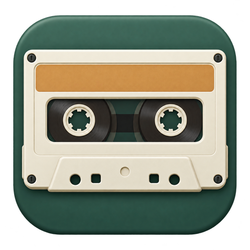
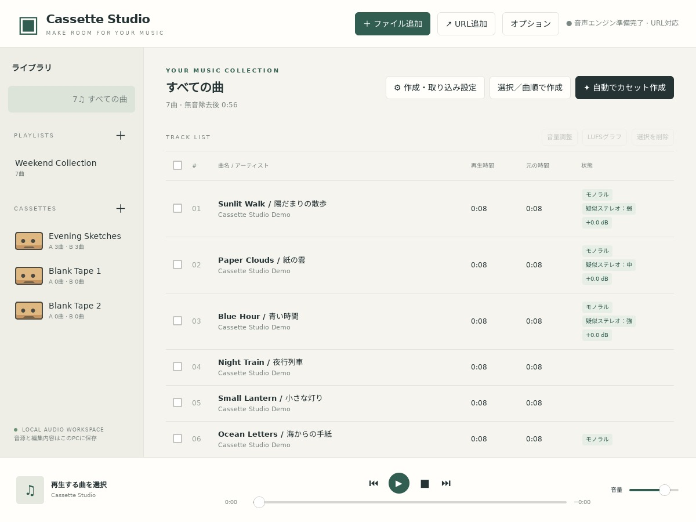
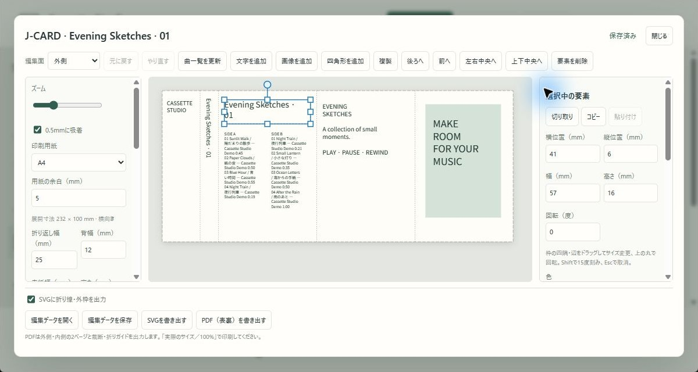

# Cassette Studio

[English](README.md) · **日本語**

カセットテープの選曲、録音用の再生、WAV出力、J-CARD作成を行うアプリです。Windows・Linux・macOSでは専用ウィンドウで使えます。日本語・英語に対応しています。

**最新版：v0.1.10** — [ダウンロード](https://github.com/syouth2002/CassetteStudio/releases/latest) · [今回の変更点](docs/release-notes-0.1.10.md)

## 読む順番

| 目的 | 説明 |
| --- | --- |
| 1. アプリを導入する | [対応環境・ダウンロード・インストール](docs/installation.ja.md) |
| 2. 曲を取り込み、カセットを作る | [使い方・機能の仕様](docs/usage.ja.md) |
| 3. ケース用の紙を作る | [J-CARDの作成・編集・印刷](docs/jcard.ja.md) |
| データを保管・移行する | [保存先とバックアップ](docs/usage.ja.md#storage) |
| ソースからビルドする | [開発環境・ビルド・検証](docs/development.ja.md) |

## できること

| 機能 | 内容 |
| --- | --- |
| 音源の取り込み | 音楽・動画ファイルのD&DとURL取り込み。同一ファイルの重複登録を防止 |
| ライブラリ管理 | プレイリストとカセットの作成、曲の追加・削除・並べ替え |
| カセット作成 | 46／60／74／80／90／120分・カスタム。実際の片面長を分・秒で指定 |
| 自動選曲 | 時間に合わせてA・B面へ配置。既存カセットの収録済み曲を除外 |
| 再生範囲の調整 | 前後の無音除外、曲間、フェード、A面からB面への引き継ぎ |
| 音の調整と確認 | 音量統一、曲ごとの音量補正、DC除去、モノラル判定・疑似ステレオ、LUFSグラフ |
| 録音の準備と出力 | 基準音、録音用再生、A・B面の16bit WAV出力（44.1／48kHz） |
| J-CARD | 外側への曲一覧配置、白紙の内側、文字・画像編集、折り返しパネル、SVG・PDF出力 |

## 最初のカセットを作る

1. [導入手順](docs/installation.ja.md)に従ってアプリと必要な音声ツールを用意します。
2. 「ファイル追加」またはD&Dで音源を取り込みます。
3. 曲を選び、「選択／曲順で作成」または「自動でカセット作成」を使います。
4. 「録音設定」で片面の時間・曲間・音量設定を確認し、試聴します。
5. 「WAV生成」で保存するか、「デッキ録音用に準備」でデッキへ音声を送ります。

操作の詳細と設定の適用範囲は[使い方・機能の仕様](docs/usage.ja.md)にまとめています。

## J-CARDを作る

カセットを選んで「J-CARDを編集」を開きます。新規カードは外側に名前と曲一覧を配置し、内側は白紙で開始します。編集、曲一覧の更新、保存、実寸印刷の手順は[J-CARDガイド](docs/jcard.ja.md)にまとめています。

## 対応環境と配布形式

Windows x64、Ubuntu 24.04 x64、Linux従来版／Flatpak／AppImage、Arch Linux x86_64、macOS 15以降（Apple Silicon／Intel）向けを配布します。ローカルのブラウザ画面でも利用できます。[各形式の必要条件と導入方法](docs/installation.ja.md)を確認してください。

画像には架空の曲名と合成音源を使用しています。ユーザーのライブラリや音楽は含みません。

## ライセンス

ソースコードとドキュメントは[MIT](LICENSE)です。依存ライブラリ・外部ツールにはそれぞれのライセンスが適用されます。[第三者ソフトウェアについて](THIRD_PARTY_NOTICES.md)を参照してください。
