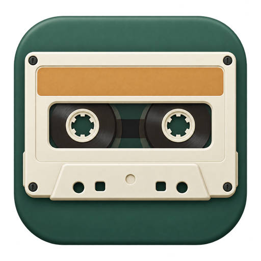
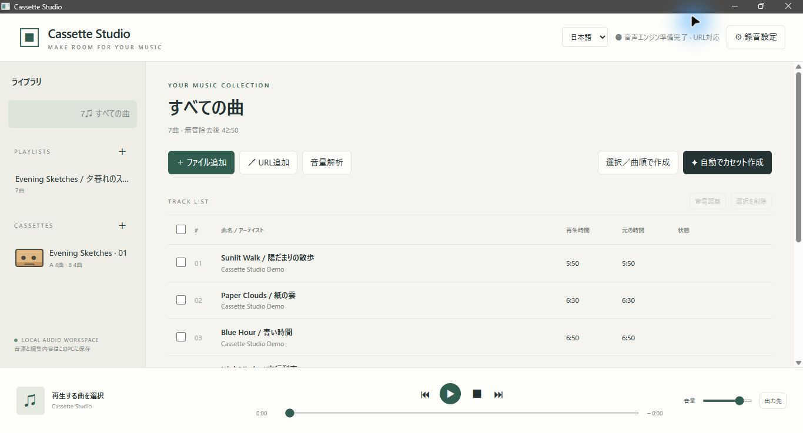
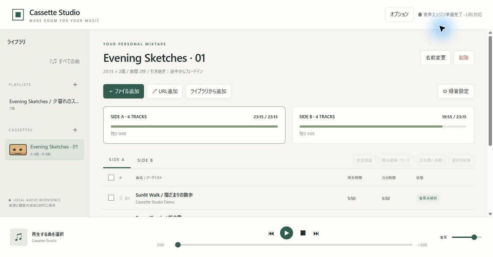
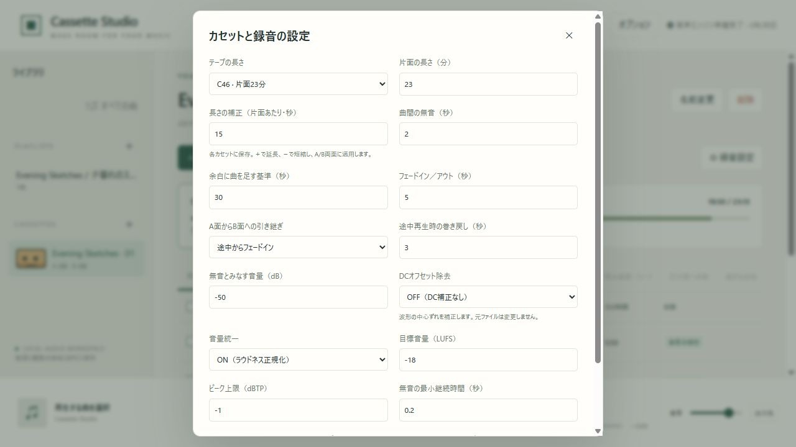

# Cassette Studio



[English](README.md) · **日本語**

カセットテープ用の選曲・録音準備アプリ。ソースコードは[MITライセンス](LICENSE)です。

## ダウンロードして使う

[GitHub Releases](https://github.com/syouth2002/CassetteStudio/releases/latest)から取得できます。

| 環境 | 配布ファイル | 初回の使い方 |
| --- | --- | --- |
| Windows x64 | `CassetteStudio-0.1.1-Windows-x64.zip` | フォルダ全体を展開し、`SetupAudioTools.cmd`でFFmpeg・FFprobe・yt-dlpを取得した後、`CassetteStudio.exe`を起動します。WebView2が必要です。 |
| Ubuntu 24.04 x64 | `CassetteStudio-0.1.1-Ubuntu24-amd64.deb` | `sudo apt install ./CassetteStudio-0.1.1-Ubuntu24-amd64.deb`で導入し、アプリ一覧から起動します。FFmpegなどは依存パッケージとして導入されます。 |
| Linux x64展開版 | `CassetteStudio-0.1.1-Linux-Ubuntu24-x64.tar.gz` | 展開後にCassetteStudioを起動します。FFmpeg・GTK 3・WebKitGTK 4.1・libxdo・D-Busを別途導入してください。 |

公開用の配布ファイルには、アプリ本体・日英の説明・画面画像・依存ライブラリのライセンスを含めています。外部音声ツールは同梱せず、別途導入します。Windowsの初回ツール取得にはネット接続が必要です。URL取り込みには[Node.js 22以上](https://nodejs.org/ja/download)、Linuxでは最新の[yt-dlp](https://github.com/yt-dlp/yt-dlp#installation)も用意してください。ローカル音声の取り込みにはNodeやyt-dlpは不要です。通常利用にRustは必要ありません。配布ファイルの検証にはリリースのSHA256SUMS.txtを使用できます。

以下は架空のデモ曲を使ったWindows版の画面です。個人のライブラリや音源は含みません。



Rustで動作する、カセットテープ用プレイリスト編集・音声書き出しアプリです。Windows / Linuxでは専用ウィンドウを持つスタンドアロンアプリとして使えます。UIはアプリ内蔵のWebView、音声処理・自動配置・保存はRustです。外部ブラウザやRustのインストールは通常利用に不要です。ブラウザ版も別途利用できます。

## ソースから作成するローカル同梱版

以下はpackage-windows.ps1・package-linux.shで手元に作成する同梱版の説明です。GitHub Releasesの公開版は冒頭の手順で導入してください。公開版には外部音声ツールを同梱していません。

- Windows：ビルド先の `CassetteStudio.exe` をダブルクリック。別PCへ移す場合は `dist/CassetteStudio-Windows-x64.zip` を展開し、フォルダ内のCassetteStudio.exeを起動してください。FFmpeg・FFprobe・yt-dlp・Nodeを同梱しています。WindowsのWebView2ランタイムを使用します。
- Ubuntu 24.04以降のx64：`dist/CassetteStudio-Ubuntu24-amd64.deb` を `sudo apt install ./CassetteStudio-Ubuntu24-amd64.deb` でインストールし、アプリ一覧のCassette Studioを起動します。GTK/WebKitGTK・FFmpegなどはパッケージの依存関係として導入されます。yt-dlpとNodeを同梱します。
- Linuxのtar.gz版：`dist/CassetteStudio-Linux-Ubuntu24-x64.tar.gz` を展開してCassetteStudioを実行します。WebKitGTK 4.1・GTK 3・libxdo・D-Bus・FFmpegとデスクトップ環境が必要です。他のディストリビューションは、その環境でソースからビルドしてください。
- 初回は動作環境の優先言語が日本語なら日本語、それ以外は英語で表示します。右上の「日本語 / English」で変更した場合は、その選択を次回も優先します。ユーザーが付けた曲名・プレイリスト名は保持します。

専用ウィンドウの起動時に音声エンジンも同じプロセスで起動し、ウィンドウを閉じると終了します。初回のツール導入後は、インターネットはURL取り込み以外の操作に不要です。内部通信は127.0.0.1:3210のみです。同じライブラリの同時起動は防止します。

## Windows / Visual Studio 2026

開発に必要な環境：Visual Studio 2026の「C++によるデスクトップ開発」、Rust stable MSVC（rustup）、WebView2、ネットワーク接続（初回ビルド・URL取り込み）。

1. 初回はPowerShellで `powershell -ExecutionPolicy Bypass -File scripts\setup-tools.ps1` を実行。FFmpeg/FFprobeとyt-dlpをプロジェクト内のtoolsに取得します。システムのPATHは変更しません。
2. `CassetteStudio.sln` をVisual Studio 2026で開きます。
3. Debug / x64、またはRelease / x64を選び、ビルドします。NMakeプロジェクトがCargoを呼び出します。
4. F5またはCtrl+F5で専用ウィンドウ版を起動します。ブラウザを開く必要はありません。

通常利用は `CassetteStudio.exe` または `CassetteStudio.cmd`。配布ファイルを作り直す場合は `powershell -ExecutionPolicy Bypass -File scripts\package-windows.ps1` を実行します。

ブラウザ版は `CassetteStudio-Browser.cmd` または `cargo run --release --bin cassette-studio --locked` を使用します。専用ウィンドウ版の起動中も <http://127.0.0.1:3210/> をブラウザで開けます。旧ブラウザ版が動作中の場合は一度終了してから専用ウィンドウ版を起動してください。

Visual Studio用プロジェクトはCargoのビルド／実行連携です。Rust専用言語サービスを同梱するものではありません。Rustファイルはソリューション内から編集できます。

## Linux

ソースからの開発にはRust stable、Cリンカー、pkg-config、GTK 3・WebKitGTK 4.1・libxdo・D-Bus・OpenSSLの開発パッケージを用意します。Ubuntuでは次のパッケージを使用できます。

```sh
sudo apt install build-essential pkg-config libgtk-3-dev libwebkit2gtk-4.1-dev libxdo-dev libdbus-1-dev libssl-dev ffmpeg
```

URLを使う場合はyt-dlpとNode.js 22以上も用意するか、配布フォルダの同梱ツールを使用してください。

```sh
sh scripts/start.sh
```

または `cargo run --release --features desktop --bin cassette-studio-desktop --locked`。ブラウザ版は `sh scripts/start-browser.sh` です。Ubuntu 24.04のWSL環境でビルド・基本テストを確認しています。



## テープ時間と補正

録音設定の時間は46 / 60 / 74 / 80 / 90 / 120分 / カスタムから選択します。「長さの補正（片面あたり・秒）」で各カセットの実測との差を補正できます。C60で＋15秒ならA/B各面30分15秒です。自動配置・残り時間・WAV書き出しは補正後の時間を使います。既存カセットは左ペインで選んでから録音設定を開きます。曲間・フェード・途中再生の巻き戻しは0.5秒刻みです。



## 使い方

- 「すべての曲」に音楽・動画ファイルをドラッグ＆ドロップ。音声の先頭・末尾の無音を解析します。動画の映像は使用せず、先頭の音声トラックを使います。
- 左ペインの＋でプレイリスト、空のカセットを作成。左ペインはテキスト一覧で表示し、カセットには小さなカセットアイコンが付きます。
- プレイリストは「ライブラリから追加」、行のドラッグ、選択削除で編集できます。曲名のダブルクリックで再生します。「すべての曲」は元音源ライブラリで、並べ替え・削除の対象ではありません。
- 曲を選択してカセットを作成。未選択なら一覧の全曲を対象にします。「選択／曲順で作成」は現在の曲順を優先、「自動」は0.1秒単位の部分和探索で各面の余白を小さくします。A面を先に確定する方式で、両面全体の最適解を保証しません。
- 片面の残り時間が基準以上なら、未配置の次の曲を入れて終端をフェードアウト。A面の途中終了曲はB面先頭に置き、最初から／続きからフェードインを選べます。巻き戻し0秒ならA面で切れた位置から再開、3秒なら3秒重ねます。
- カセットも曲順変更、曲追加・削除、反対面への移動、曲の開始位置・長さ・フェードを編集できます。手動編集では勝手な再選曲をせず、時間超過を表示します。フェードや引き継ぎの範囲は一覧から編集できます。
- 設定の引き継ぎ方式や余白基準は新しいカセット作成時に適用されます。既存の面を変更する場合は再生範囲編集を使うか、元のプレイリストから再作成してください。
- 無音設定は新規取り込みへ適用。既存音源の再解析は作成済みカセットを削除してから実行します。途中の無音は保持します。両端無音が除去された後、指定の曲間無音を挿入します。
- 画面下部に再生／一時停止／停止、前後の曲、シーク、音量、時間表示があります。対応ブラウザでは出力先も選択可能です。
- カセット再生は、書き出しと同じ音声を生成してから再生します。曲間・フェードが一致します。A面終了で停止し、テープを裏返してB面を開始します。
- 「デッキ録音用に準備」で現在の面を準備。デッキで録音を開始し、「5秒後に再生開始」を押してください。ハードウェアの録音ボタンを直接制御する機能ではありません。
- WAV保存リンクは生成したカセットを選んでいるときだけ表示し、収録内容や設定を変更すると非表示になります。
- 書き出しはA/B各面のWAV（44.1kHz / 16bit / ステレオ）。末尾の残り時間は無音で埋め、指定した片面長にします。
- URLはyt-dlp対応サイトの単一動画・音声を取り込みます。プレイリストURLの一括展開、DRM、ログイン必須コンテンツは対象外です。サイト側の変更や取得制限によって失敗する場合があります。

## データと実行設定

### 曲の音量を揃える

「録音設定」の「音量統一」をONにすると、曲全体（前後の無音除去後）のラウドネスとトゥルーピークを基準に一定の音量補正を適用します。初期値は目標−18 LUFS、ピーク上限−1 dBTPです。既存データの音を変更しないよう、初期状態はOFFです。設定は選択したプレイリスト／カセットごとに保存します。「すべての曲」ではブラウザ内の既定設定として保存します。

「音量解析」は選択曲、未選択なら表示中の曲全体を解析し、一覧の補正量表示に反映します。新しい音源は取り込み時に解析し、古い音源も再生・書き出し時に必要に応じて解析します。元ファイルは変更しません。

曲を1曲選んで「音量調整」を押すと、測定値を確認し、−24〜＋24 dBの手動補正を設定できます。手動補正は同じ音源を使う全プレイリスト・カセットへ共通適用し、自動補正がONならそれに加算します。音量統一OFF・手動0 dBのときは音量補正を行いません。

曲中の強弱を圧縮せず、曲全体へ一定のゲインを適用します。ピーク上限を優先するため、強弱差の大きい曲では目標LUFSに届かないことがあり、「ピーク制限」と表示します。ピークには測定・PCM丸めのため0.1 dBの余裕を持たせます。音量を測定できない短い音源や全体が無音の音源では、自動の増幅は行いません。

試聴、録音用再生、WAV書き出しは共通の補正処理を使います。A面とB面へまたがる曲も元の曲全体の解析結果を使うので、途中部分だけを別音量へ正規化しません。設定・手動補正が変わると試聴用キャッシュも切り替えます。既に書き出したWAVは再書き出しが必要です。

`node scripts/test-loudness.mjs` で、音量差のある合成音源、目標LUFS、ピーク上限、ON/OFF、手動補正、引き継ぎ、既存データ読み込み、保存を検証できます。測定にはFFmpegのloudnormを使用します：<https://ffmpeg.org/ffmpeg-filters.html#loudnorm>

### あらかじめ用意した空カセットへ配置

左ペインのCASSETTESの＋で空カセットを作ると、録音時間の設定画面が開きます。必要な本数を作り、それぞれの時間を設定してください。プレイリストまたは「すべての曲」で「自動でカセット作成」を押すと、空カセットの配置先一覧が開きます。選択した曲（未選択なら一覧の全曲）を、各カセットの保存済み設定に合わせて一覧順に配分します。空カセットを選んだ画面からの自動配置では、ライブラリ全曲を候補にします。

同じ音源IDは1回だけ候補にし、既存カセットの収録済み曲と、今回ほかのカセットへ配置した曲は除外します。A面末尾からB面先頭への引き継ぎは同じ1曲の継続として保持します。曲不足で埋まらないカセットは空のまま残し、未配置曲数を表示します。収録済みカセットは上書きしません。同じ曲を別ファイルとして取り込み直したものや別バージョンは、別音源として扱います。

データは `data/library.json`、元音源は `data/sources/`、試聴用は `data/preview/`、書き出しは `data/exports/`。元ファイルを編集せず、取り込んだコピーを保持します。不要な書き出し・試聴キャッシュはアプリ終了後に削除できます。バックアップはdataフォルダ全体をコピーします。

アプリは127.0.0.1のみに接続を受け付けます。ブラウザ版もRustの音声エンジンと同じPCで使用します。ブラウザ単体のWASM版や外部公開サーバーは含みません。

環境変数：`CASSETTE_PORT`（既定3210）、`CASSETTE_DATA`（データ保存場所）、`CASSETTE_FFMPEG` / `CASSETTE_FFPROBE` / `CASSETTE_YT_DLP` / `CASSETTE_NODE`（ツールのフルパス）。ツールは環境変数→実行ファイルの横のtools→開発用tools→PATHの順で探します。

開発中は既存のプロジェクト内dataを使用します。Windows配布ZIPにはportable.txtがあり、そのフォルダのdataに保存します。portable.txtのないインストール版はOSのアプリ用データフォルダへ保存します（Linuxは通常 `~/.local/share/cassettestudio`、WindowsはLocalAppData内）。WebViewの言語設定なども同じ保存場所に保持します。アプリの配布ファイルにはユーザーの音源を含めません。

```sh
cargo test --locked
cargo clippy --features desktop --all-targets --locked -- -D warnings
cargo build --release --features desktop --bins --locked
node scripts/test-i18n.cjs
node scripts/test-tape-settings.cjs
node scripts/test-downloads.cjs
```

FFmpegがある環境で `cargo build --locked` の後に `node scripts/smoke-test.mjs` を実行すると、合成した音楽・動画を使い、無音解析、両方の引き継ぎ、WAVの秒数、フェードの音量変化、保存、HTTP Range、時間超過の拒否を一括検証します。テスト用データはwork配下に保存され、通常のライブラリには入りません。

## 外部ツール

- FFmpeg: <https://ffmpeg.org/download.html> / Windows配布元 <https://www.gyan.dev/ffmpeg/builds/>
- yt-dlp: <https://github.com/yt-dlp/yt-dlp>

外部バイナリを再配布する際は各ツールのライセンスと配布条件を確認してください。セットアップは配布元のSHA-256と照合します。

## 古い日本語タグの文字化け

Shift_JIS/CP932の日本語タグがLatin-1として読み取られ、制御文字を含む場合は、正しく復元できるものを自動補正します。既存ライブラリも起動時に確認し、補正前の情報をdata内のlibrary-before-tag-repair.jsonへ保存します。元の音楽ファイルは変更しません。正しいUnicodeや欧文タグは保持します。文字コードの自動判定は全形式を保証せず、既に「?」や置換文字に失われた情報は復元しません。

## ライセンス

本プロジェクトは[MIT](LICENSE)です。外部ツールや依存ライブラリには別のライセンスが適用されます。[第三者ソフトウェアについて](THIRD_PARTY_NOTICES.md)を参照してください。

## 公開用パッケージの作成

Windowsはscripts/package-public-windows.ps1、Linuxはビルド後にscripts/package-public-linux.shを使用します。dist/releases/v0.1.1/へアプリ本体のみの配布ファイルを作ります。依存関係のライセンス収集にPython 3とRustに付属する著作権表示ファイルが必要です。従来のpackage-windows.ps1・package-linux.shは外部ツール同梱のローカル用パッケージを作成する補助スクリプトで、公開リリースには使用しません。

## DCオフセットの除去

録音設定の「DCオフセット除去」をONにします。初期値はOFFで、プレイリスト・カセットごとに保存します。「音量・DC解析」は選択曲、未選択なら表示中の全曲を解析します。既存曲も、補正を有効にした再生・書き出し時に必要に応じて解析します。曲を1曲選んで音量調整を開くと、左右別のDC量をフルスケールに対する割合（%）で確認できます。

無音除去後の曲全体で左右別の平均値を求め、音量補正・フェードより前に差し引きます。補正後の音量・トゥルーピークを別に測定して音量統一へ使い、音量統一OFFでもピーク上限を守ります。試聴・デッキ録音用再生・WAV書き出しは共通処理です。B面への引き継ぎも曲全体の同じDC量を使います。元ファイルは変更しません。

DC除去ONで取り込む場合は補正前後で両端の無音を確認します。設定を変えても既存の再生範囲は変えません。無音範囲も更新する場合は既存カセットを削除して音源を再解析してください。この機能は一定の平均ずれを除去するもので、時間変動する低域を除去するフィルターや、デッキの録音バイアス調整ではありません。

`node scripts/test-dc.mjs`で、合成音源による左右別補正、モノラル、無音、曲の両端、試聴/WAV一致、フェード、A/B引き継ぎ、音量統一、ピーク制限、旧データ、保存、元ファイル保持を検証できます。
