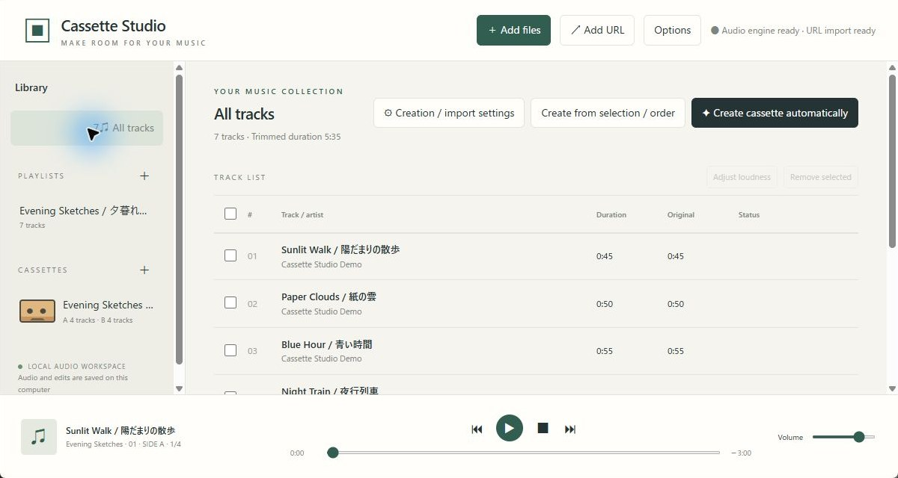
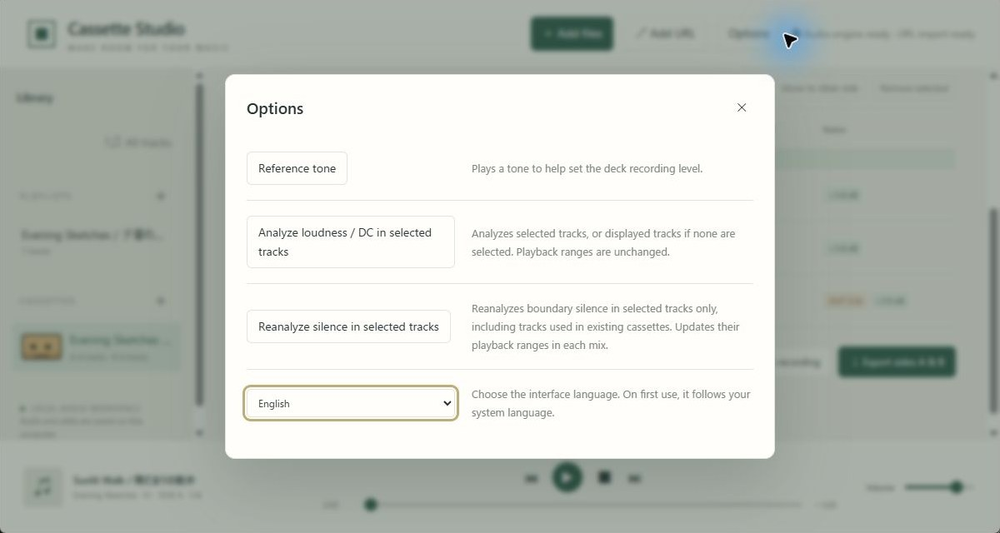
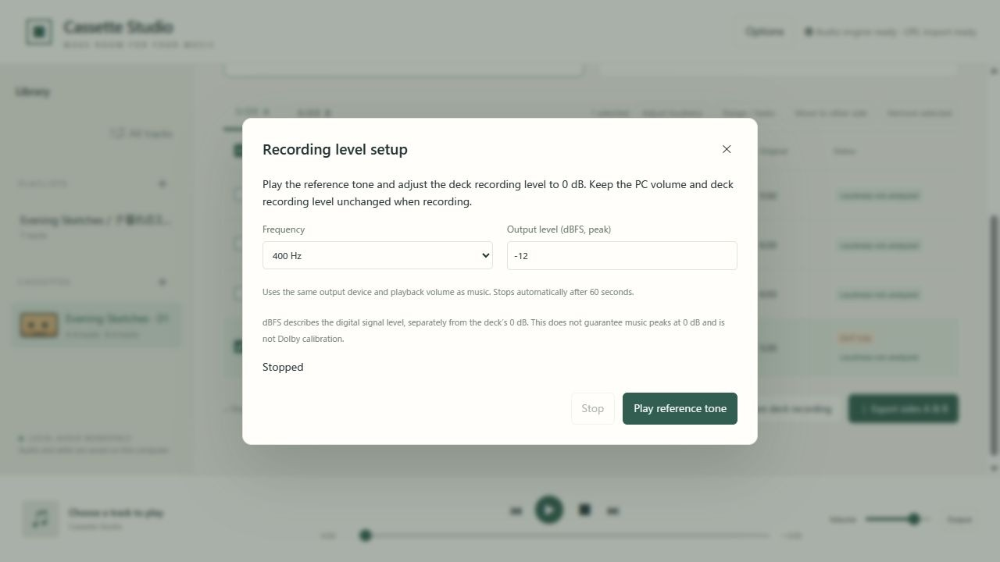
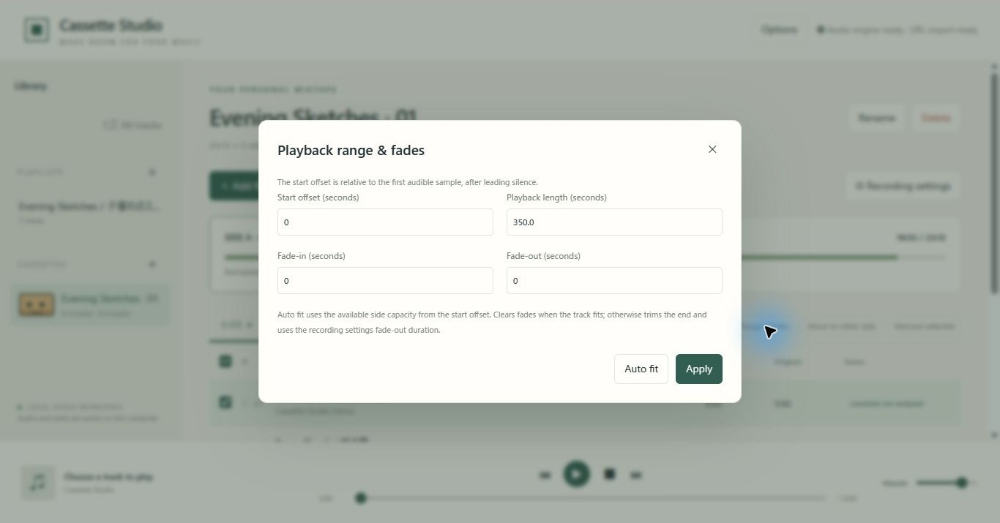
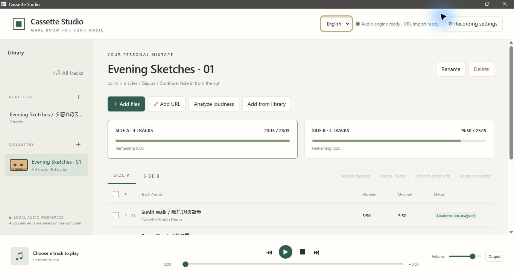
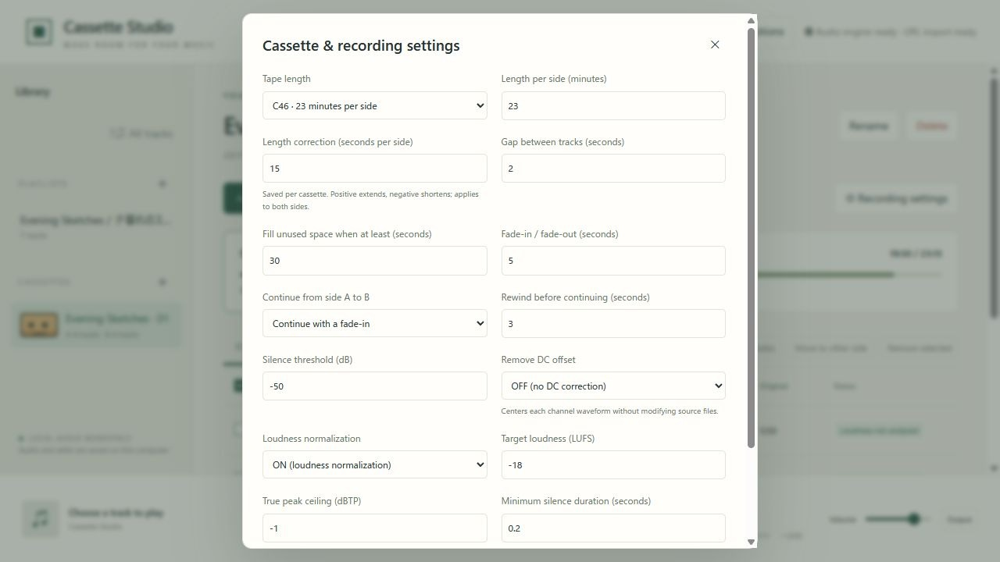

# Cassette Studio


**English** · [日本語](README.ja.md)

A Rust application for arranging cassette mixtapes, preparing deck playback, and exporting audio. Windows, Linux and macOS run in a standalone desktop window with an embedded WebView. A local browser interface is also available. The interface supports Japanese and English.

Source code and documentation: [MIT](LICENSE). Dependencies and external tools retain their own licenses; see [third-party notices](THIRD_PARTY_NOTICES.md).

Version 0.1.2 includes Options, a recording reference tone, playback-range auto fit and macOS application packages.

## Download and start

Get the application from [GitHub Releases](https://github.com/syouth2002/CassetteStudio/releases/latest).

| Platform | Download | First use |
| --- | --- | --- |
| Windows x64 | `CassetteStudio-0.1.2-Windows-x64.zip` | Extract the entire folder, run `SetupAudioTools.cmd` once to obtain FFmpeg/FFprobe and yt-dlp, then run `CassetteStudio.exe`. WebView2 must be installed. |
| Ubuntu 24.04 x64 | `CassetteStudio-0.1.2-Ubuntu24-amd64.deb` | Run `sudo apt install ./CassetteStudio-0.1.2-Ubuntu24-amd64.deb`, then start Cassette Studio from the app menu. FFmpeg and system runtimes are installed as dependencies. |
| Linux x64 archive | `CassetteStudio-0.1.2-Linux-Ubuntu24-x64.tar.gz` | Extract and launch `CassetteStudio`. Install FFmpeg, GTK 3, WebKitGTK 4.1, libxdo and D-Bus first. |
| Arch Linux x86_64 | `cassette-studio-0.1.2-1-x86_64.pkg.tar.zst` | Fully update Arch, then install using `sudo pacman -U ./cassette-studio-0.1.2-1-x86_64.pkg.tar.zst`. |
| macOS 15+ Apple Silicon | `CassetteStudio-0.1.2-macOS-arm64.zip` | Extract, move `Cassette Studio.app` to Applications and install external tools as described below. |
| macOS 15+ Intel | `CassetteStudio-0.1.2-macOS-x64.zip` | Same steps; use the Intel archive. |

Release downloads contain the app, bilingual instructions, screenshots and dependency notices. External audio tools are installed separately; they are not bundled in the public release. Windows first-time audio-tool setup needs internet access. For URL imports, install [Node.js 22+](https://nodejs.org/en/download); Linux also needs a current [yt-dlp](https://github.com/yt-dlp/yt-dlp#installation). Local audio imports do not need Node or yt-dlp. Rust is not needed to use these downloads. Check archive integrity against the release's `SHA256SUMS.txt`.

Screenshots show the latest browser interface with fictional demo tracks. The desktop application uses the same controls. No personal library or music is included.

## Features

- Drag audio or video files into the library; videos use their first audio stream.
- Create playlists and A/B cassettes; reorder tracks, add/remove them, move them between sides, and edit playback ranges and fades.
- Choose 46, 60, 74, 80, 90, or 120 minutes, or a custom length. Store a correction in seconds per side for each cassette. C60 with +15 seconds gives 30:15 on each side.
- Arrange selected tracks in order, or automatically fill pre-created empty cassettes using their individual settings, without reusing track IDs already present in other cassettes.
- Exclude leading/trailing silence from track length; preserve silence within a track and insert the configured gap between tracks.
- Fill sufficiently large remaining space with a track faded out at the side's end. Continue it on side B from the beginning, or from the cut position with a fade-in and optional rewind.
- Set gaps, fade-in/out, and continuation rewind in 0.5-second increments.
- Play/pause/stop, seek, adjust volume, and skip tracks. The text sidebar includes small cassette icons.
- Export A/B WAV files at 44.1 kHz, 16-bit stereo, padded to corrected capacity. Save links appear only for the selected cassette's generated audio; editing its contents or settings invalidates them.
- Prepare playback for a cassette deck with a five-second countdown. The application's controls do not operate the deck's hardware recording button.
- Import individual URLs supported by yt-dlp. Playlist expansion, DRM, and sign-in-required media are not supported.
- Recover a detectable legacy Japanese tag encoding error without modifying source media.

First launch selects Japanese when the environment's preferred language is Japanese, otherwise English. Choose the language in **Options**; a manual selection takes priority on subsequent launches. User-provided titles are preserved.



## Options

Open **Options** in the top-right corner for shared tools and language selection. Each control has a short explanation.

| Control | Scope and effect |
| --- | --- |
| Reference tone | Plays a tone for setting the deck recording level. |
| Analyze loudness / DC | Measures selected tracks, or displayed tracks if none are selected. Keeps playback ranges; measurements are shared by cassettes using the same source. Enable corrections separately in recording settings. |
| Reanalyze silence in the entire library | Updates leading/trailing silence and playback ranges using the current recording/import settings. Unavailable while any cassette contains tracks. |
| Language | Select Japanese or English. First launch follows the environment; a manual selection is saved. |

Loudness/DC measurement and silence reanalysis are separate operations. Completion notifications remain visible in front of the open Options dialog.



## Recording reference tone

1. Connect the PC audio output to the deck recording input.
2. Open **Options → Reference tone**. Choose 400Hz or 1kHz and a peak level from −30 to −3dBFS. Defaults: 400Hz, −12dBFS peak.
3. Press **Play reference tone** and adjust the deck recording level to 0dB. The tone uses the same output device and playback volume as music.
4. Press **Stop** or close the dialog, then record music without changing PC output volume or deck recording level. The tone also stops automatically after 60 seconds.

Deck 0dB and digital dBFS are separate references. This does not guarantee music peaks at 0dB and is not Dolby calibration.



## Playback range and fade auto fit

Select one cassette entry, open **Range / fades**, then press **Auto fit**. Review the result and press **Apply** to save it. Closing without applying leaves the entry unchanged.

- When the source from the selected start offset to its end fits, restores that full remaining length and clears both fades.
- When it overflows, trims the end to available side capacity after accounting for all other entries and gaps, then applies the recording settings fade-out duration.
- Playback length is displayed to one decimal place and edited in 0.1-second steps. Display rounding alone preserves the existing precise duration.
- Manual cassette additions use the same capacity and end-fade calculation. Entries with no available space are skipped with a notification; sources remain in the library. Manual additions do not automatically create side-B continuations.
- Fades use 0.5-second increments within the entry length. Fragments shorter than 0.5 seconds receive no fade.

Recording settings are in the cassette toolbar. Other views show **Creation / import settings**.



## Platform and planned-feature status

Windows x64, Ubuntu 24.04 x64, Arch Linux x86_64, macOS 15+ (Apple Silicon / Intel), and the browser interface are supported build targets. macOS packages are built separately on GitHub-hosted Mac runners and checked for native app startup, audio import and DC/fade WAV rendering. Physical audio output and deck recording on a Mac have not been verified.

Dolby B/C-compatible encoding and decoding are not implemented. See the [Japanese research report with an English summary](docs/dolby-b-c-research.ja.md) for technical sources, calibration and interoperability work still required.

## Windows / Visual Studio 2026

Install Rust stable for MSVC, Visual Studio 2026 with **Desktop development with C++**, and WebView2. Install Node.js 22+ for JavaScript tests and URL extraction. First-time dependency downloads need network access.

From the repository directory:

```powershell
powershell -ExecutionPolicy Bypass -File scripts\setup-tools.ps1
cargo build --release --features desktop --bins --locked
```

Setup downloads FFmpeg, FFprobe and yt-dlp to `tools/` and checks their SHA-256 sums. It does not modify PATH or install Node.js.

Open `CassetteStudio.sln`, select Debug or Release / x64, and build. F5 or Ctrl+F5 launches the desktop app. Visual Studio calls Cargo; a Rust language service is not included.

Alternatively, `CassetteStudio.cmd` builds the desktop executable if absent and starts it. `CassetteStudio-Browser.cmd` starts browser mode. Close any existing instance using the same library first.

```powershell
powershell -ExecutionPolicy Bypass -File scripts\package-windows.ps1
```

Local packaging creates `CassetteStudio.exe` in the repository and `dist/CassetteStudio-Windows-x64.zip`. Extract the whole ZIP and run `CassetteStudio.exe`. The package includes external tools and requires WebView2; normal use does not need Rust or an external browser. Review [redistribution requirements](THIRD_PARTY_NOTICES.md) before publishing binaries.

## Linux

Ubuntu 24.04 x64 is the tested build environment. Install Rust stable and these packages:

```sh
sudo apt install build-essential pkg-config libgtk-3-dev libwebkit2gtk-4.1-dev libxdo-dev libdbus-1-dev libssl-dev ffmpeg
sh scripts/start.sh
```

For URL import, also install yt-dlp and Node.js 22+, or supply the tools from a local package. A desktop session and GTK/WebKitGTK runtimes are required.

```sh
cargo run --release --features desktop --bin cassette-studio-desktop --locked
sh scripts/start-browser.sh
```

For local packaging, copy the release executables to `dist/linux-x64/` as `CassetteStudio` and `cassette-studio-browser`, then run `sh scripts/package-linux.sh`. The WSL helpers `setup-linux-build.sh` and `build-linux-wsl.sh` install an isolated Rust toolchain and build in `/var/tmp/`.

- `dist/CassetteStudio-Ubuntu24-amd64.deb`: install using `sudo apt install ./CassetteStudio-Ubuntu24-amd64.deb`, then launch from the application menu. System runtimes and FFmpeg are dependencies; Node and yt-dlp are included.
- `dist/CassetteStudio-Linux-Ubuntu24-x64.tar.gz`: extract and run `CassetteStudio`. Install GTK 3, WebKitGTK 4.1, libxdo, D-Bus, FFmpeg and a desktop environment separately.

Other distributions should build from source. Linux build, startup, import, normalization, preview, and WAV export have been checked on Ubuntu 24.04 under WSL2/Xvfb. Physical Linux audio-device playback has not been verified.

## Using cassettes

Import into **All tracks**, then use the sidebar + buttons to create playlists or empty cassettes. Double-click a track to play it. The source library cannot be reordered or deleted through the playlist editor; edit a playlist or cassette instead.



Select a cassette and open **Recording settings** in its toolbar to choose its nominal length and per-side correction. A single correction applies to both sides. Automatic arrangement, remaining-space displays, playback rendering and WAV export use corrected capacity.

To fill several empty cassettes, create them and save their settings first. Use **Create cassette automatically** from a playlist or All tracks, then select destinations. Selected tracks are candidates, or the full displayed list when none are selected. Starting from an empty cassette uses the full library. Filled cassettes are not overwritten; some destinations can remain empty if tracks are insufficient.

Duplicate prevention uses source track IDs. An A-to-B continuation counts as one track. The same recording imported as another file is a separate source. The planner uses a 0.1-second subset-sum search and completes A first; it does not guarantee a global optimum for both sides or all cassettes. Manual edits retain your order and report overflow.

Continuation and fill settings affect newly arranged cassettes. For an existing cut, edit the playback range or recreate the cassette. With zero rewind, continuation starts at the cut; three seconds repeats the preceding three seconds. Silence settings apply to new imports. Reanalyzing existing media requires removing created cassettes first.

For deck recording, connect computer audio to the deck, prepare the selected side, start the deck's recording, then start the five-second playback countdown. Side A stops at its end; turn the tape over and start B separately. Use media you are entitled to record.



## Loudness

Enable automatic loudness normalization in Recording settings to apply constant gain from the whole trimmed track's integrated loudness and true peak. Defaults are -18 LUFS and a -1 dBTP ceiling; automatic normalization is initially off. Settings are saved per playlist/cassette, while All tracks uses local defaults.

New imports are analyzed automatically. **Analyze loudness** processes selected tracks, or all displayed tracks when none are selected. Older tracks are analyzed as needed for playback/export. Select one track to apply additional manual gain from -24 to +24 dB, shared across collections using that source.

Dynamics are preserved rather than compressed. Peak protection may prevent reaching the target; the UI reports peak limiting. A 0.1 dB margin accounts for measurement/PCM rounding. Unmeasurable short or silent sources are not automatically amplified. Preview, deck playback and export use the same correction; continued tracks use the original full-track measurement. Changes invalidate preview caches; existing WAVs must be exported again. Source files are unchanged.

## Storage and browser mode

The engine listens on `127.0.0.1:3210` by default. The desktop starts it in the same process and stops it when the window closes. Browser mode uses the same local engine; this is not a browser-only WASM application or a public hosting service. Local editing and playback do not require internet access.

The data directory contains `library.json`, copied media in `sources/`, previews in `preview/`, and generated WAVs in `exports/`. Back up the whole directory. Remove unneeded previews/exports while the application is closed.

- Development uses existing project `data/`, if present.
- Windows portable ZIP uses adjacent `data/`, selected by `portable.txt`.
- Installed copies without `portable.txt` use OS application data: normally LocalAppData on Windows and `~/.local/share/cassettestudio` on Linux.

WebView preferences use the same root. Distribution files and this repository exclude user libraries and music. Multiple instances using one library are blocked. Output-device selection depends on browser/WebView support.

| Environment variable | Purpose |
| --- | --- |
| `CASSETTE_PORT` | Local port; default 3210 |
| `CASSETTE_DATA` | Data-directory override |
| `CASSETTE_FFMPEG`, `CASSETTE_FFPROBE`, `CASSETTE_YT_DLP`, `CASSETTE_NODE` | Full paths to external tools |

Tool discovery checks overrides, `tools/` beside the executable, the executable directory, development `tools/`, and PATH.

## Arch Linux

The Arch package is built from source in the official Arch Linux container using Arch packages; it is separate from the Ubuntu build. Update your system before installing:

```sh
sudo pacman -Syu
sudo pacman -U ./cassette-studio-0.1.2-1-x86_64.pkg.tar.zst
cassette-studio
```

The desktop entry is also available in your application menu. `cassette-studio-browser` starts the local browser interface. Runtime dependencies, including FFmpeg and WebKitGTK 4.1, are resolved by pacman. For URL imports, optionally install `yt-dlp` and `nodejs`. File dialogs require a working desktop portal backend; on GTK/Xfce desktops install `xdg-desktop-portal-gtk` if no suitable backend is configured.

To rebuild, download **PKGBUILD** and **CassetteStudio-0.1.2-Arch-source.tar.gz** from the same release into an empty folder, inspect PKGBUILD, then run as a regular user:

```sh
sudo pacman -S --needed base-devel rust pkgconf python
makepkg -si
```

The source archive is checked against the SHA-256 embedded in PKGBUILD. It is a release-specific snapshot including the Arch packaging and updated documentation; the application version remains 0.1.2. The repository template is `packaging/arch/PKGBUILD.in`, and `scripts/prepare-arch-package.py` generates the concrete checksummed files from the current commit.

This is a GitHub download, not an official Arch repository or AUR package. Arch is rolling release software; the package is tested against the build-time repository state and may need rebuilding after system library changes. CI checks package installation, native-window startup under Xvfb, audio import, DC/fade WAV generation and embedded UI assets. Physical sound output, deck recording, and every desktop/Wayland combination are not covered by these checks.

## macOS

Download the **arm64** archive for Apple Silicon or **x64** for Intel. Extract the folder, move **Cassette Studio.app** to Applications, and launch it. The app uses macOS WebKit; Rust and an external browser are unnecessary for normal desktop use.

Audio tools are not bundled. With [Homebrew](https://brew.sh) installed, run:

```sh
brew install ffmpeg
# Optional, for URL imports:
brew install yt-dlp node
```

The archive also includes **SetupAudioTools.command**, which installs all three through an existing Homebrew installation. Finder launches find tools in `/opt/homebrew/bin` and `/usr/local/bin`, in addition to the usual tool overrides and PATH.

**The macOS app is ad-hoc signed, without Apple Developer ID signing or notarization.** Gatekeeper may prevent it from opening under default security settings. It is an experimental distribution; see [Apple's explanation of unidentified developers](https://support.apple.com/guide/mac-help/open-a-mac-app-from-an-unknown-developer-mh40616/mac). No signing certificate or notarization account is included.

For development, install Xcode Command Line Tools and Rust stable, then run:

```sh
cargo run --release --features desktop --bin cassette-studio-desktop --locked
# Package the current Mac architecture:
sh scripts/package-public-macos.sh 0.1.2
```

Apple Silicon and Intel packages are built separately. `scripts/test-macos-package.py` tests the packaged native app and browser executable using synthetic audio and a temporary library. These checks do not replace physical playback/recording tests.

## DC offset removal

In Recording settings, enable **Remove DC offset** (initially OFF). The option is saved per playlist/cassette. **Analyze loudness / DC** analyzes selected tracks, or the displayed list when none are selected; older tracks are analyzed automatically when correction is needed for playback or export. The track loudness dialog shows separate left/right offsets as a percentage of full scale.

The arithmetic mean of each channel over the trimmed track is subtracted before gain and fades. Corrected loudness/true peak are measured separately from the original and used for normalization and peak protection. Preview, deck playback and WAV export share the same processing. A track continued onto B retains the whole track's offset, rather than measuring each fragment. Source files are unchanged. The peak ceiling is enforced when DC correction is on, even with normalization off.

When importing with DC removal enabled, boundary silence is checked both before and after correction. Changing the setting does not alter existing track ranges: reanalyze sources if boundary trimming also needs updating. Existing cassettes must be removed before the silence reanalysis operation. Correction removes a constant mean offset; it is not a time-varying low-cut filter and does not control a deck's recording bias.

## Legacy Japanese tags

Some files contain Shift_JIS/CP932 bytes tagged as Latin-1. When metadata contains diagnostic control characters and decodes cleanly to Japanese, titles and artists are repaired. Correct Unicode and Western text are preserved. Existing libraries are checked at startup, with the original saved as `library-before-tag-repair.json` before correction. Audio files are unchanged.

This targeted recovery does not detect all encodings. Information already replaced by `?` or replacement characters cannot be reconstructed.

## Validation

```sh
cargo fmt --check
cargo test --locked
cargo clippy --features desktop --all-targets --locked -- -D warnings
cargo build --release --features desktop --bins --locked
node scripts/test-i18n.cjs
node scripts/test-tape-settings.cjs
node scripts/test-downloads.cjs
node scripts/test-reference-tone.cjs
node scripts/test-entry-fit.cjs
```

With FFmpeg available in `tools/` or set using `CASSETTE_FFMPEG`, build the CLI debug binary with `cargo build --locked`, then run:

```sh
node scripts/smoke-test.mjs
node scripts/test-batch.mjs
node scripts/test-loudness.mjs
node scripts/test-dc.mjs
```

Tests generate synthetic media under `work/` and use isolated libraries. Coverage includes silence trimming, continuation, fades, WAV length, loudness/peak protection, batch arrangement, persistence, HTTP Range and overflow rejection.

## License

[MIT](LICENSE), copyright 2026 syouth2002. Dependencies and external tools remain under their own licenses; see [THIRD_PARTY_NOTICES.md](THIRD_PARTY_NOTICES.md). The project license grants no rights to third-party music or videos.

## Building public release packages

Use `scripts/package-public-windows.ps1` on Windows, `scripts/package-public-linux.sh` after building the Linux binaries, and `scripts/package-public-macos.sh` on each Mac architecture. These create application-only packages under `dist/releases/v0.1.2/`. Python 3 is required to collect exact dependency notices; keep the copyright files supplied with the Rust toolchain available. The separate `package-windows.ps1` and `package-linux.sh` helpers create local bundles with external tools and are not used for the public release.
