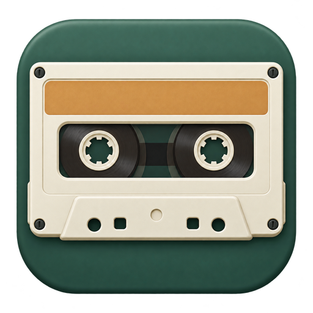
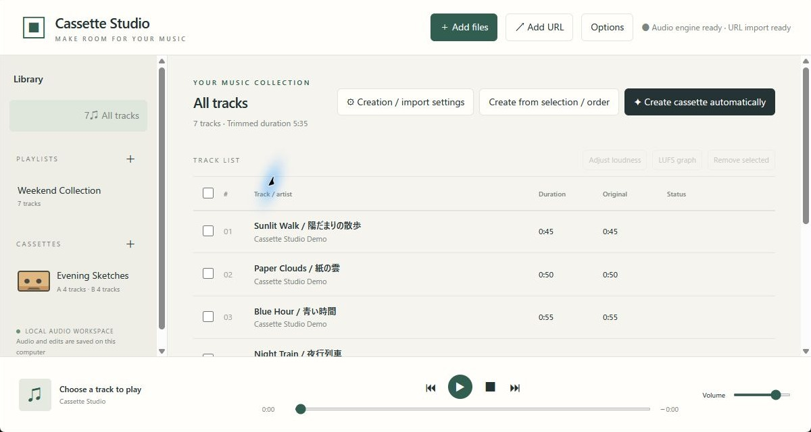
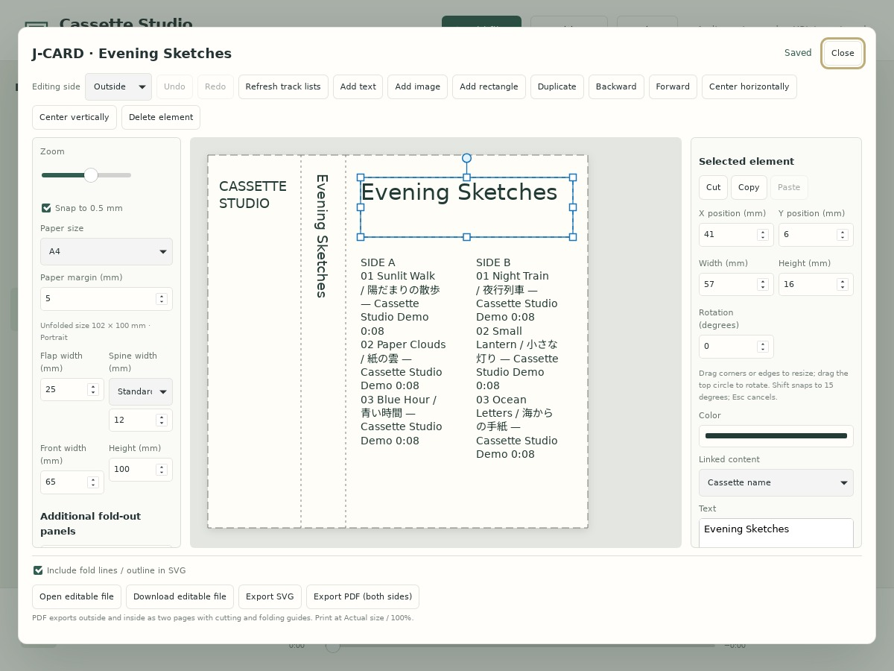

# Cassette Studio

**English** · [日本語](README.ja.md)

Arrange cassette mixtapes, prepare deck playback, export WAV audio and design J-CARDs. Windows, Linux and macOS use a standalone desktop window. The interface supports Japanese and English.

**Version 0.1.10** — [Download](https://github.com/syouth2002/CassetteStudio/releases/latest) · [Release changes](docs/release-notes-0.1.10.md)

## Where to start

| Goal | Guide |
| --- | --- |
| 1. Install the app | [Platforms, downloads and installation](docs/installation.md) |
| 2. Import music and create a cassette | [User guide and feature specifications](docs/usage.md) |
| 3. Make a case insert | [J-CARD design, editing and printing](docs/jcard.md) |
| Back up or move your data | [Storage and backup](docs/usage.md#storage) |
| Build from source | [Development, builds and validation](docs/development.md) |

## Features

| Feature | What it does |
| --- | --- |
| Media import | Drag/drop audio or video files, or import a URL. Prevents duplicate file registrations |
| Library management | Create playlists/cassettes; add, remove and reorder entries |
| Cassette lengths | 46/60/74/80/90/120 minutes or custom; enter actual per-side minutes and seconds |
| Automatic arrangement | Fits tracks to A/B sides, excluding recordings already used on existing cassettes |
| Playback ranges | Boundary-silence trimming, track gaps, fades and A-to-B continuation |
| Audio adjustment and analysis | Normalization, per-track gain, DC removal, mono detection/pseudo stereo and LUFS graphs |
| Recording and output | Reference tone, prepared deck playback and 16-bit A/B WAV exports at 44.1/48 kHz |
| J-CARD design | Outside track lists, a blank inside, text/images, fold-out panels, SVG and PDF output |

## Make your first cassette

1. Follow the [installation guide](docs/installation.md) to install the app and required audio tools.
2. Use **Add files** or drag/drop to import media.
3. Select tracks and choose **Create from selection / order** or **Create cassette automatically**.
4. Check side duration, gaps and audio settings in **Recording settings**, then audition the result.
5. Generate and save WAV files, or use **Prepare deck recording** to play audio to a deck.

The [user guide](docs/usage.md) explains the controls, workflow and scope of each setting.

## Make a J-CARD

Select a cassette and open **Edit J-CARD**. A new card has its title and track lists on the outside and starts with a blank inside. Editing, list updates, saving and actual-size printing are covered together in the [J-CARD guide](docs/jcard.md).

## Platforms and package formats

Downloads cover Windows x64, Ubuntu 24.04 x64, traditional Linux/Flatpak/AppImage, Arch Linux x86_64 and macOS 15+ (Apple Silicon/Intel). A local browser interface is also available. See the [requirements and installation steps for each format](docs/installation.md).

Screenshots use fictional titles and synthetic media; they contain no personal library or music.

## License

Source code and documentation use the [MIT license](LICENSE). Dependencies and external tools retain their own licenses; see [third-party notices](THIRD_PARTY_NOTICES.md).
