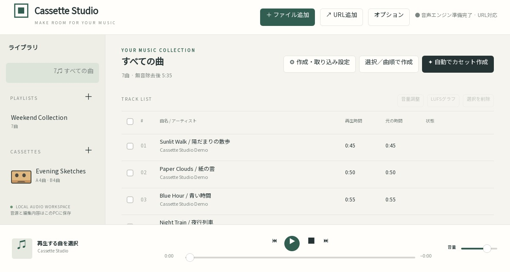
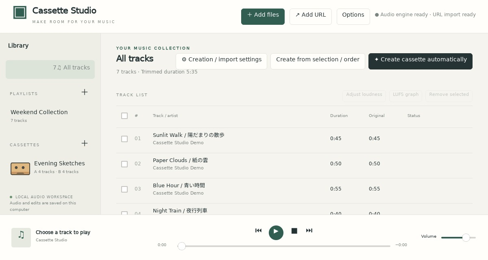

# 対応環境・インストール

[トップ](../README.ja.md) · [English](installation.md) · 次：[使い方](usage.ja.md)

<a name="downloads"></a>

## 1. 配布ファイルを選ぶ

[GitHub Releases](https://github.com/syouth2002/CassetteStudio/releases/latest)から取得します。通常利用にRustやVisual Studioは不要です。

| 環境 | v0.1.9のファイル | 音声・URLツール |
| --- | --- | --- |
| Windows x64 | `CassetteStudio-0.1.9-Windows-x64.zip` | 同梱のセットアップで取得 |
| Ubuntu 24.04 x64 | `CassetteStudio-0.1.9-Ubuntu24-amd64.deb` | FFmpegは依存関係として導入。URL用ツールは追加導入 |
| Linux従来版 x64 | `CassetteStudio-0.1.9-Linux-Ubuntu24-x64.tar.gz` | 外部ツール・画面用ライブラリを別途導入 |
| Linux Flatpak x86_64 | `CassetteStudio-0.1.9-x86_64.flatpak` | 同梱。GNOME 49ランタイムを使用 |
| Linux AppImage x86_64 | `CassetteStudio-0.1.9-x86_64.AppImage` | 同梱。glibc 2.39以降のUbuntu 24.04互換環境向け |
| Arch Linux x86_64 | `cassette-studio-0.1.9-1-x86_64.pkg.tar.zst` | FFmpegなどはpacmanで導入。URL用ツールは追加導入 |
| macOS 15以降・Apple Silicon | `CassetteStudio-0.1.9-macOS-arm64.zip` | Homebrewなどで別途導入 |
| macOS 15以降・Intel | `CassetteStudio-0.1.9-macOS-x64.zip` | Homebrewなどで別途導入 |

配布物には日英ドキュメント・画面画像・依存ライブラリのライセンスを含めています。整合性は同じリリースの`SHA256SUMS.txt`で確認できます。Arch用ソース・PKGBUILD、Linux同梱ライブラリ用ソースは再ビルドなどに使うもので、通常の起動には不要です。

## 2. 環境別の導入

### Windows

1. ZIPをフォルダーごと展開します。
2. `SetupAudioTools.cmd`を実行し、FFmpeg／FFprobe／yt-dlpを取得します。初回はネット接続が必要です。
3. `CassetteStudio.exe`を起動します。WebView2ランタイムが必要です。
4. URL取り込みを使う場合は[Node.js 22以上](https://nodejs.org/ja/download)も導入します。

フォルダー内の実行ファイルだけを移動せず、フォルダー全体を保管してください。

### Ubuntu

```sh
sudo apt install ./CassetteStudio-0.1.9-Ubuntu24-amd64.deb
```

アプリ一覧からCassette Studioを起動します。GTK・WebKitGTK・FFmpegなどは依存関係として導入されます。URL取り込みには最新の[yt-dlp](https://github.com/yt-dlp/yt-dlp#installation)とNode.js 22以上も用意してください。

### Linux従来版

tar.gzを展開し、`CassetteStudio`を起動します。Ubuntu 24.04互換のx64環境と、GTK 3・WebKitGTK 4.1・libxdo・D-Bus・FFmpeg・デスクトップ環境が必要です。URL取り込みにはyt-dlpとNode.js 22以上も必要です。

共通ランタイムを利用したい場合はFlatpak、ライブラリをまとめた形式を使いたい場合はAppImageを選べます。

### Flatpak

```sh
flatpak remote-add --user --if-not-exists flathub https://flathub.org/repo/flathub.flatpakrepo
flatpak install --user ./CassetteStudio-0.1.9-x86_64.flatpak
flatpak run io.github.syouth2002.CassetteStudio//local
```

GNOME 49の共通ランタイムを使用します。初回はネット接続とランタイム用の追加容量が必要です。アプリ一覧では「Cassette Studio (Flatpak)」です。GitHubから導入するバンドルで、Flathubのアプリ一覧には登録していません。

FFmpeg・FFprobe・yt-dlp・Node.jsと日本語・記号フォントを同梱します。音声・画面・ネットワークを利用し、ホストの音源を読み取り専用で参照します。保存先の選択はデスクトップポータルを使い、ホスト全体への書き込みやホストコマンド実行は許可しません。`CASSETTE_DATA`でホスト側の任意の保存先を指定する場合は、そのフォルダーへの書き込み許可も必要です。



### AppImage

```sh
chmod +x CassetteStudio-0.1.9-x86_64.AppImage
./CassetteStudio-0.1.9-x86_64.AppImage
```

FUSEが使えない場合：

```sh
APPIMAGE_EXTRACT_AND_RUN=1 ./CassetteStudio-0.1.9-x86_64.AppImage
```

GTK・WebKitGTK、音声・URLツール、日本語・記号フォントを同梱します。基礎ライブラリやグラフィックドライバーはOSを利用するため、すべてのLinux環境での動作を保証するものではありません。現在のビルドはglibc 2.39以降のUbuntu 24.04互換環境向けです。



### Arch Linux

```sh
sudo pacman -Syu
sudo pacman -U ./cassette-studio-0.1.9-1-x86_64.pkg.tar.zst
cassette-studio
```

Archのライブラリを使う専用ビルドです。URL用に`yt-dlp`・`nodejs`を追加導入できます。ファイル選択にはデスクトップに合ったポータルが必要です。GTK／Xfceなどで未設定なら`xdg-desktop-portal-gtk`を用意します。

GitHub配布で、Arch公式リポジトリやAURへの登録ではありません。ローリング更新に伴うライブラリ変更で再ビルドが必要になる場合があります。

### macOS

CPUに合うZIPを展開し、`Cassette Studio.app`をアプリケーションへ移動します。macOSのWebKitを使用します。

[Homebrew](https://brew.sh)の導入後：

```sh
brew install ffmpeg
# URL取り込みを使う場合：
brew install yt-dlp node
```

同梱の`SetupAudioTools.command`でもHomebrewを使って3ツールを取得できます。Finder起動では`/opt/homebrew/bin`・`/usr/local/bin`も検索します。

macOS版はアドホック署名で、Developer ID署名・公証はありません。Gatekeeperで制限される場合は[Appleの説明](https://support.apple.com/ja-jp/guide/mac-help/mh40616/mac)を確認してください。

<a name="coverage"></a>

## 3. 形式の併用と確認範囲

Flatpak・AppImageは通常版と保存先を分け、空いている内部通信ポートを選びます。既存ライブラリやOSのFFmpegを置換しません。保存先・移行方法は[保存先とバックアップ](usage.ja.md#storage)にまとめています。

Ubuntu／Linux共通パッケージはUbuntu 24.04・WSL2・仮想画面で、macOSはApple Silicon／IntelのMacランナーで、ArchはArchのコンテナー環境で起動・音声処理を検証しています。物理音声機器、実際のWayland、D&D／保存ポータルの全組み合わせ、印刷機の実寸・表裏位置は別途確認が必要です。

導入後は[使い方・機能の仕様](usage.ja.md)へ進んでください。ソースから作る場合は[開発者向けガイド](development.ja.md)を参照してください。
