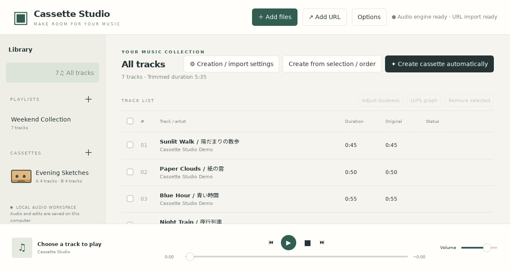
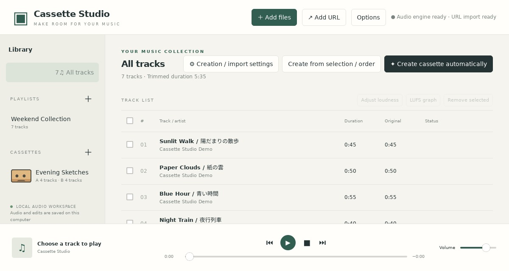

# Platforms and installation

[Home](../README.md) · [日本語](installation.ja.md) · Next: [User guide](usage.md)

<a name="downloads"></a>

## 1. Choose a download

Get files from [GitHub Releases](https://github.com/syouth2002/CassetteStudio/releases/latest). Normal use does not require Rust or Visual Studio.

| Platform | Version 0.1.10 file | Audio and URL tools |
| --- | --- | --- |
| Windows x64 | `CassetteStudio-0.1.10-Windows-x64.zip` | Download using the supplied setup helper |
| Ubuntu 24.04 x64 | `CassetteStudio-0.1.10-Ubuntu24-amd64.deb` | FFmpeg is a dependency; install URL tools separately |
| Traditional Linux x64 | `CassetteStudio-0.1.10-Linux-Ubuntu24-x64.tar.gz` | Install external tools and GUI libraries separately |
| Linux Flatpak x86_64 | `CassetteStudio-0.1.10-x86_64.flatpak` | Bundled; uses GNOME 49 |
| Linux AppImage x86_64 | `CassetteStudio-0.1.10-x86_64.AppImage` | Bundled; targets Ubuntu 24.04-compatible systems with glibc 2.39+ |
| Arch Linux x86_64 | `cassette-studio-0.1.10-1-x86_64.pkg.tar.zst` | FFmpeg and runtimes via pacman; optional URL tools |
| macOS 15+ Apple Silicon | `CassetteStudio-0.1.10-macOS-arm64.zip` | Install through Homebrew or equivalent |
| macOS 15+ Intel | `CassetteStudio-0.1.10-macOS-x64.zip` | Install through Homebrew or equivalent |

Packages include bilingual documentation, screenshots and dependency notices. Check integrity against the release's `SHA256SUMS.txt`. Arch sources/PKGBUILD and Linux bundled-library sources are for rebuilding and similar uses; they are not required to launch the app.

## 2. Install on your platform

### Windows

1. Extract the entire ZIP folder.
2. Run `SetupAudioTools.cmd` to obtain FFmpeg, FFprobe and yt-dlp. Initial setup needs internet access.
3. Start `CassetteStudio.exe`. WebView2 is required.
4. For URL imports, also install [Node.js 22+](https://nodejs.org/en/download).

Keep the whole extracted folder together.

### Ubuntu

```sh
sudo apt install ./CassetteStudio-0.1.10-Ubuntu24-amd64.deb
```

Start Cassette Studio from the application menu. GTK, WebKitGTK, FFmpeg and other dependencies are installed through apt. For URL imports, also install a current [yt-dlp](https://github.com/yt-dlp/yt-dlp#installation) and Node.js 22+.

### Traditional Linux

Extract the tar.gz and run `CassetteStudio`. This targets Ubuntu 24.04-compatible x64 systems and requires GTK 3, WebKitGTK 4.1, libxdo, D-Bus, FFmpeg and a desktop session. URL imports also require yt-dlp and Node.js 22+.

Choose Flatpak for a shared runtime, or AppImage for a package bundling GUI libraries.

### Flatpak

```sh
flatpak remote-add --user --if-not-exists flathub https://flathub.org/repo/flathub.flatpakrepo
flatpak install --user ./CassetteStudio-0.1.10-x86_64.flatpak
flatpak run io.github.syouth2002.CassetteStudio//local
```

Uses GNOME 49. First installation needs network access and extra runtime space. The launcher is named Cassette Studio (Flatpak). This is a GitHub bundle, not a Flathub app listing.

FFmpeg, FFprobe, yt-dlp, Node.js, Japanese fonts and symbol fonts are bundled. Display, audio and network access are allowed; host media are readable but not globally writable. Save dialogs use desktop portals. Host command execution is not granted. An arbitrary host directory selected through `CASSETTE_DATA` also needs a matching write permission.



### AppImage

```sh
chmod +x CassetteStudio-0.1.10-x86_64.AppImage
./CassetteStudio-0.1.10-x86_64.AppImage
```

Without FUSE:

```sh
APPIMAGE_EXTRACT_AND_RUN=1 ./CassetteStudio-0.1.10-x86_64.AppImage
```

Bundles GTK/WebKitGTK, media/URL tools and Japanese/symbol fonts. Base libraries and graphics drivers still come from the OS. The current build requires an Ubuntu 24.04-compatible system with glibc 2.39+; universal Linux compatibility is not claimed.



### Arch Linux

```sh
sudo pacman -Syu
sudo pacman -U ./cassette-studio-0.1.10-1-x86_64.pkg.tar.zst
cassette-studio
```

This is a native Arch build using Arch libraries. Optionally install `yt-dlp` and `nodejs` for URLs. File dialogs need a desktop portal backend; GTK/Xfce sessions can use `xdg-desktop-portal-gtk` when no suitable backend is configured.

This is a GitHub download, not an official Arch repository or AUR listing. Rolling system-library updates may require rebuilding.

### macOS

Extract the ZIP matching your CPU, then move `Cassette Studio.app` to Applications. The app uses macOS WebKit.

After installing [Homebrew](https://brew.sh):

```sh
brew install ffmpeg
# Optional, for URL imports:
brew install yt-dlp node
```

The supplied `SetupAudioTools.command` also installs all three through Homebrew. Finder launches search `/opt/homebrew/bin` and `/usr/local/bin` too.

The macOS app is ad-hoc signed without Developer ID signing or notarization. If Gatekeeper blocks it, consult [Apple's explanation](https://support.apple.com/guide/mac-help/open-a-mac-app-from-an-unknown-developer-mh40616/mac).

<a name="coverage"></a>

## 3. Coexistence and validation scope

Flatpak and AppImage have separate storage from native packages and select free internal ports. They do not replace existing libraries or system FFmpeg. See [storage and backup](usage.md#storage) for locations and migration.

Ubuntu/Linux bundles are tested on Ubuntu 24.04 under WSL2 with a virtual display; macOS uses Apple Silicon/Intel Mac runners; Arch uses an Arch container. Checks cover startup and audio processing. Physical audio devices, real Wayland sessions, all drag/drop/save-portal combinations and physical print alignment need additional checks.

Continue with the [user guide and specifications](usage.md). To build from source, see the [development guide](development.md).
