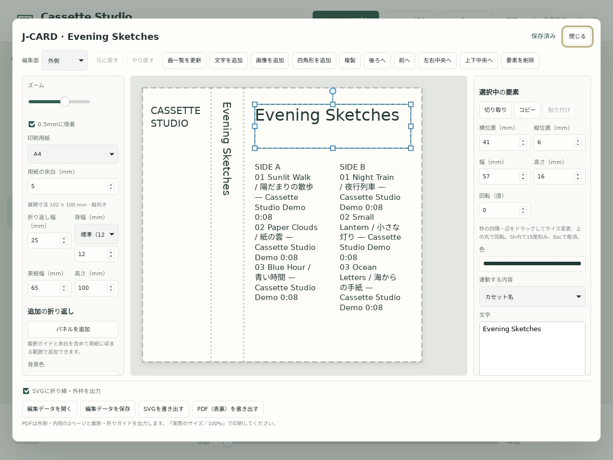
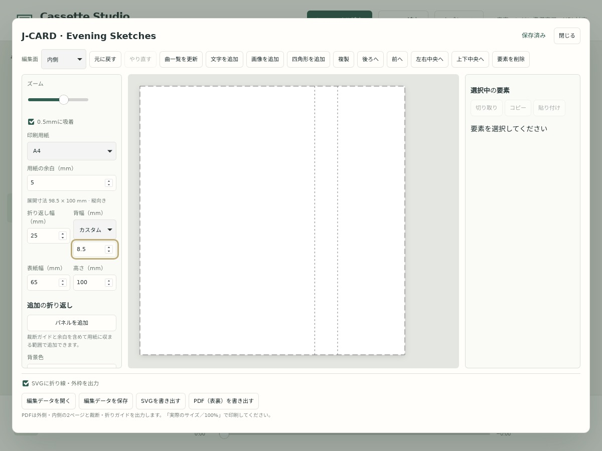

# J-CARDの作成・編集・印刷

[トップ](../README.ja.md) · [使い方](usage.ja.md) · [English](jcard.md)

J-CARDはカセットケースに入れる紙です。初期配置から編集・保存・印刷までを、このページにまとめています。

## 1. カセットから作る

カセットを選び、右ペインの「J-CARDを編集」を押します。

- **外側**：カセット名、A/B面の曲名・アーティスト・収録時間を連動する文字枠へ自動配置します。
- **内側**：白紙・白背景で開始します。「曲一覧を更新」だけでは内側に文字を追加しません。
- 保存済みのデザインはそのまま開きます。音源・曲順は変更しません。
- 初期寸法は表紙65mm・背12mm・折り返し25mm・高さ100mmです。ケースを実測して調整してください。

## 2. 外側・内側を切り替える

「編集面」で切り替えます。内側にも文字・画像などを自由に追加できます。文字は鏡文字にせず、見たまま編集します。折り位置だけを裏返した配置にし、PDFの表裏は同じ用紙位置へ出力します。

## 3. 文字・画像・図形を編集する

1. 上部の「文字を追加」「画像を追加」「四角形を追加」で要素を置きます。
2. キャンバスまたは左の要素一覧で選び、ドラッグして移動します。
3. 右ペインで位置・サイズ・回転・色を調整します。文字には書体・大きさ・揃え・行間・太字・縦書きを指定できます。

| 操作 | 方法 |
| --- | --- |
| リサイズ | 四隅・辺の四角をドラッグ。文字サイズは固定し、枠に合わせて折り返す |
| 回転 | 枠の上の丸をドラッグ。Shift併用で15度刻み |
| 移動 | ドラッグ、またはキャンバス上で矢印キー（0.5mm、Shift併用で5mm） |
| 位置を揃える | 左ペインの0.5mm吸着、中央揃え、右ペインの数値指定 |
| 重なり順・複製・削除 | 上部のボタン |
| 取り消す | 元に戻す／やり直す。ドラッグ中はEsc |

回転済みの枠も反対側の位置を保ってリサイズします。ズームと吸着は左ペイン、選択枠の操作説明は右ペインの色設定の上です。

## 4. ミックスリストの変更を反映する

カセットを編集したら「曲一覧を更新」を押します。最新の保存済みミックスリストを読み込み、**連動する文字枠だけ**を更新します。位置・書式・回転は保持します。

- 外側の既定の曲一覧は、そのまま更新できます。
- 独自の枠は「連動する内容」でカセット名・背表紙・SIDE A／Bなどを指定します。
- 自由な文章を残す枠は「自由入力（更新しない）」にします。文章を手で編集するだけでは連動は外れません。
- 内側に自分で追加した連動枠も更新できます。白紙の内側へ自動で枠を作ることはありません。
- 旧バージョンの既定の曲一覧枠で連動が外れていた場合も認識します。

## 5. 外側と内側の間で移動・複製する

要素を選び、右ペインの「切り取り」→編集面を変更→「貼り付け」で移動します。「コピー」なら複製できます。対応するパネルへ配置し、書式・回転・連動先を保持します。

Ctrl/Cmd+X・C・Vにも対応します。J-CARD要素用のアプリ内クリップボードです。入力欄内の文字を選んで行う通常のカット・コピー・貼り付けは別の操作です。

## 6. 寸法・折り返しパネル・用紙を決める

左ペインで表紙・背・折り返し・高さ、A4／レター、用紙余白を指定します。寸法変更は既存の文字・画像を自動拡大縮小しません。

背幅は「標準（12mm）」または「カスタム」を選びます。スリムケースなどは実測した幅をカスタムで入力してください。既存のJ-CARDの背幅は保持します。

追加パネルは表紙の右側へ加えます。幅は10〜100mmで、裁断ガイド用に周囲5mmと指定した用紙余白を確保し、**1枚の紙に実寸で収まる範囲**だけ追加できます。

初期寸法・余白5mmでは、65mm幅の追加パネルはA4／レターとも最大2枚です。展開幅は追加なし102mm、+1で167mm、+2で232mm。細いパネルなら追加数が増えるため、+2固定ではなく寸法で制限します。別紙を綴じる冊子には対応しません。

外側の既存配置は維持し、内側は元の表紙・背・折り返しに追従して横移動します。削除したパネル上の要素は保持するので、必要に応じて移動してください。

## 7. 保存・再編集する

編集内容はカセットごとに自動保存し、右上に状態を表示します。「閉じる」は保存完了を待ちます。失敗時は閉じず、変更を保持します。同じカセットの「J-CARDを編集」から再開できます。

「編集データを保存」は持ち出し用の`.jcard.json`を書き出します。「編集データを開く」で以前のデザインを呼び出したり、別のカセットへ使ったりできます。画像・両面・全パネル・用紙設定を含みます。

自動保存先はデータフォルダーの`jcards`です。[保存先とバックアップ](usage.ja.md#storage)を参照してください。カセットを削除してもファイルは残りますが、その削除済みカセットからは開けなくなります。

## 8. SVG・PDFを出力して印刷する

| 出力 | 内容 |
| --- | --- |
| SVG | 選択中の面を実寸で出力。折り線・外枠の有無を選べる |
| PDF | 外側・内側の2ページ。A4／レターの同じ位置へ実寸配置し、収まる向きを自動選択 |
| PDFのガイド | 裁断用の長い点線・四隅のマーク、折り用の短い点線・上下のマーク |

印刷は**「実際のサイズ／100%」**を指定し、自動縮小しないでください。両面印刷は縦向きでは長辺とじ、横向きでは短辺とじを基本に、試し刷りで表裏の位置と寸法を確認します。

PDFは日本語の見た目を保つ300dpiの画像で、選択枠やハンドルを出しません。文字を選択・編集できるベクターPDFではありません。SVGの文字は編集できますが、他ソフトのフォントによって外観が変わる場合があります。

## 9. 編集機能の範囲

ゴシック・明朝・等幅の3系統を使い、実際のフォントは環境によります。画像は1点5MB以下のPNG/JPEG、要素は各面150個、保存リクエストは12MBまでです。

自由描画、画像トリミング、文字単位の混在書式、DOCX入出力は未対応です。概算の文字あふれ警告は表示しません。検証手順は[開発者向けガイド](development.ja.md)にまとめています。
