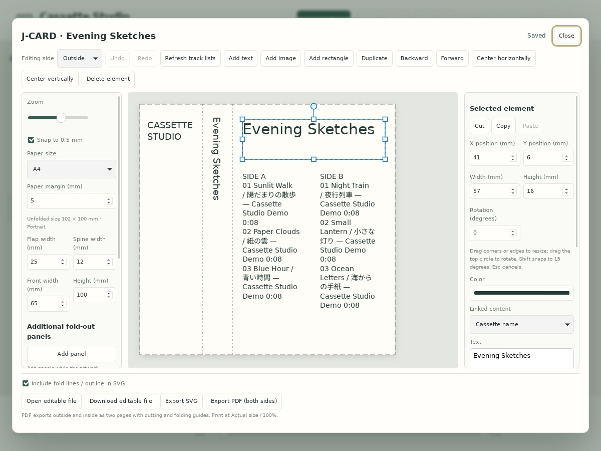
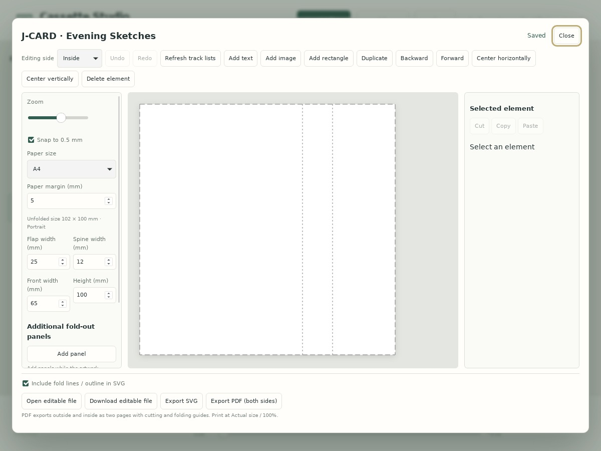

# J-CARD editor

Select a cassette and choose **Edit J-CARD** in the right pane. A new card starts with an editable layout populated from cassette data. Default dimensions are front 65 mm, spine 12 mm, flap 25 mm and height 100 mm. Measure your case and adjust them. Changing dimensions does not scale artwork automatically.

- Cassette title and side A/B track titles, artists and recorded durations populate linked text boxes. **Refresh track lists** updates linked boxes only. Text edits retain their links; refreshing replaces the text from the mix. Choose Free text (do not update) under Linked content to opt out.
- Add text, PNG/JPEG images and rectangles. Drag on the canvas, or edit position, dimensions, rotation and color in the properties panel. Text supports size, family, alignment, line spacing, bold and vertical writing.
- Drag the square corner/edge handles to resize a selected box, or the circle above it to rotate. Hold Shift while rotating to snap to 15 degrees. Resizing a rotated box keeps its opposite anchor fixed. Font size stays unchanged and text reflows. Images and rectangles use the same handles. Esc cancels an active drag; one Undo reverses the entire drag.
- Snap to 0.5 mm, center, change stacking order, duplicate, delete, undo and redo. Select from the elements list too. With canvas focus, arrow keys move by 0.5 mm; Shift increases this to 5 mm.
- Artwork autosaves per cassette under jcards in the app data directory. **Close** waits for saving to finish. Save status appears at the top; a failed save keeps the editor open and retains changes. It does not change audio or track order. Deleting a cassette retains its artwork file, but the deleted cassette can no longer open it.
- Download an editable .jcard.json file and open it for another cassette to reuse a design. Embedded images are included.
- SVG uses physical dimensions. PDF places outside and inside on two pages, at identical actual-size positions on A4 or Letter. Orientation is chosen to fit. Print at **Actual size / 100%**, without automatic scaling.
- PDF embeds a 300 dpi image to retain Japanese text appearance; it does not contain selectable vector text. SVG text remains editable, but font differences in other software can alter its appearance.

The initial editor provides sans-serif, serif and monospace families using locally available fonts. PDF uses the preview artwork without selection outlines or handles. Approximate text-overflow warnings are not displayed. PDF always includes dashed cut and fold lines plus corner/fold marks; SVG guides are optional. Freehand paths, image cropping, mixed formatting within a text box and DOCX are not implemented. Limits: 5 MB per PNG/JPEG image, 150 elements per side and 12 MB per save request.

Checks: `node scripts/test-jcard.cjs` (model, bindings, SVG and PDF structure), `node scripts/test-jcard-api.mjs` (isolated storage, reload and rejected invalid documents). Physical print dimensions should be checked separately.

## Two sides and fold-out panels

Switch between Outside and Inside. Inside artwork remains readable, with mirrored fold positions rather than mirrored text. New cards place track lists on the outside only and start with a blank white inside. Refreshing track lists does not add content to an empty inside. You can add and link text manually; existing saved artwork is preserved. Version 1 artwork migrates without changing outside elements and gains an empty inside.

Add fold-out panels to the right of the front. Panel widths range from 10 to 100 mm. The entire card must fit on one sheet at actual size, including 5 mm for guide marks on every edge and the selected paper margin. Dimension and paper changes use the same check; artwork is never automatically reduced. Default dimensions (front 65, spine 12, flap 25, height 100 mm, margin 5 mm) allow at most two additional 65 mm panels on either A4 or Letter. The unfolded widths are 102 / 167 / 232 mm for +0 / +1 / +2. Narrower panels may allow more, so the limit is geometric rather than a fixed +2. Separate-sheet booklets are not supported.

Outside artwork stays in place when panels are added/removed. Inside artwork shifts to retain its position relative to the original front/spine/flap. Elements on removed panels are retained, so check the preview and move them as needed. Undo changes are autosaved too. Editable files contain both sides, all panels and print settings.

For duplex printing, start with long-edge binding for portrait and short-edge binding for landscape, then check a test print and your printer's settings/alignment. The two PDF pages represent both sides of one sheet. Physical printer alignment is not guaranteed.

`node scripts/test-jcard-editor.cjs` checks independent faces, autosave, close flushing, retained changes after save errors and ordering of edits arriving during a save.

Zoom and 0.5 mm snapping are in the left pane. Selected-element handle instructions appear above the color setting in the right pane. Save status appears only at the top right.

## Refreshing lists and moving boxes

Refresh track lists fetches the latest saved cassette and updates linked text boxes on both faces, preserving formatting, placement and rotation. Original legacy track-list boxes with cleared bindings are recognized. For custom boxes, choose their source under Linked content before refreshing.

Select a box, use Cut (Ctrl/Cmd+X), switch the editing side, then Paste (Ctrl/Cmd+V). Copy (Ctrl/Cmd+C) duplicates it instead. The editor retains styling, rotation and linked content and places it on the corresponding panel. Undo/redo and autosave apply. Images and rectangles work the same way.

These object operations use an in-app J-CARD clipboard. Native text cut/copy/paste inside input fields continues to work normally.

