# 使い方・機能の仕様

[トップ](../README.ja.md) · [導入手順](installation.ja.md) · [English](usage.md)

取り込みから録音までの順に説明します。ケースに入れる紙の作成は[J-CARDガイド](jcard.ja.md)にまとめています。

## 目次

- [画面の見方](#workspace)
- [音源の取り込みとライブラリ管理](#import)
- [カセットの作成と選曲](#cassettes)
- [録音設定・時間・無音・フェード](#recording-settings)
- [音量・音質と解析](#audio)
- [再生・デッキ録音・WAV出力](#output)
- [オプションと言語](#options)
- [保存先とバックアップ](#storage)
- [ブラウザ利用と未実装の機能](#browser)

## 画面の見方

左ペインで「すべての曲」・プレイリスト・カセットを選び、右ペインでその曲一覧を操作します。左ペインはテキスト一覧と小さなカセットアイコンです。

| 場所 | 主な操作 |
| --- | --- |
| 上部 | ファイル追加・URL追加・オプション |
| 右ペインの見出し | 作成／取り込み設定、カセット作成。カセット選択時はライブラリから追加・録音設定・名前変更・削除 |
| 曲一覧 | 選択、音量調整、LUFSグラフ、削除。カセットではA/B切り替え・再生範囲／フェード・反対面への移動 |
| 下部 | 再生／一時停止／停止、前後の曲、シーク、音量、録音用の準備、WAV生成 |

曲をダブルクリックして再生できます。A/B切り替え・編集操作・列見出しは、曲一覧をスクロールしても上部に残ります。

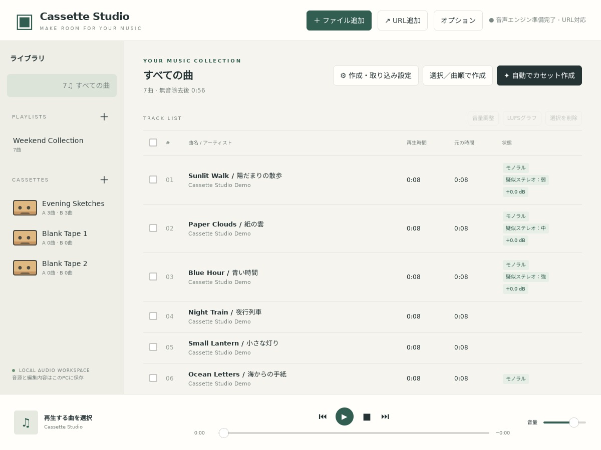

## 音源の取り込みとライブラリ管理

### ファイルとURL

- 「ファイル追加」またはD&Dで音楽・動画ファイルを追加します。動画は最初の音声ストリームを使用します。
- 「URL追加」はyt-dlp対応サイトの単一動画・音声を対象にします。プレイリスト一括展開、DRM、ログイン必須コンテンツは対象外です。サイト側の変更で取得できない場合があります。
- 同一ファイルは名前が違っても重複登録しません。同じ名前で内容が違うもの、形式・タグ・バージョンが異なるファイルは別音源です。プレイリストやカセットへ取り込む場合も、そのリストの同じ音源を重複登録しません。
- 取り込んだ音源はアプリの保存先へコピーします。元ファイルは編集しません。

### プレイリスト・削除

左ペインの＋でプレイリストや空カセットを作れます。プレイリスト・カセット内では曲順を変更でき、曲を追加・削除できます。「すべての曲」の並び順は変更できません。

「すべての曲」で「選択を削除」すると、確認後にライブラリ登録と全プレイリスト・カセット内の参照を取り除きます。元音源と取り込み済みコピーは保持します。プレイリスト内の削除はそのリストだけが対象です。

### 曲名の文字化け

一部のShift_JIS／CP932タグがLatin-1として誤読された場合は、復元できるものを補正します。正しいUnicode・欧文タグは保持します。既存ライブラリの補正前情報は`library-before-tag-repair.json`へ保存します。すべての文字コードを検出する機能ではなく、既に「?」などへ失われた文字は復元できません。

## カセットの作成と選曲

### 手動で作る

1. 「すべての曲」またはプレイリストを開き、収録する曲を選びます。未選択なら一覧の全曲が候補です。
2. 「作成・取り込み設定」で片面長などを指定します。
3. 「選択／曲順で作成」を押し、名前を入力します。現在の曲順を優先して配置します。

ミックスリスト名の初期候補は番号付きで生成し、既存名との重複を避けます。手動作成では、別のカセットで使った曲も選べます。

### 自動で作る・空カセットへ配置する

「自動でカセット作成」は、既存カセットのA・B面に収録済みの曲を候補から除外します。選択曲にも適用し、未収録の再生可能な曲がなければ案内を表示します。

- **空カセットがない場合**：現在の設定で新しいカセットを作成します。
- **空カセットがある場合**：配置先の選択画面を開きます。各カセットの保存済み設定を使って順番に配分し、同じ曲を複数本へ重ねません。
- 空カセットは左ペインのCASSETTESの＋で用意し、片面長・曲間などを設定しておきます。
- プレイリスト／「すべての曲」では選択曲、未選択なら一覧の全曲が候補です。空カセットから開始する場合はライブラリ全曲が候補です。
- 収録済みカセットは上書きしません。曲が不足して配置できなかったカセットは空のまま残し、未配置曲数を表示します。

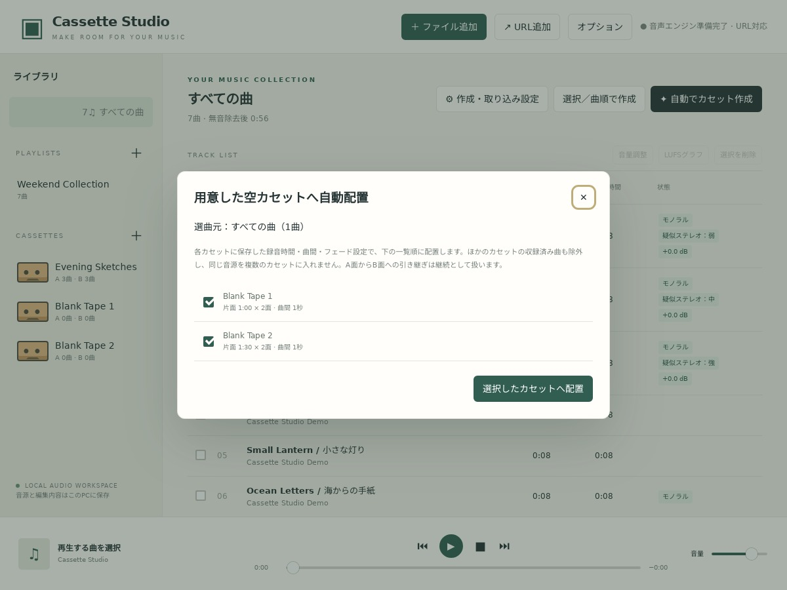

重複除外は音源ID単位です。同じ曲でも別形式・別タグなどの別音源は同一曲として照合しません。A面からB面への引き継ぎは1曲として扱います。自動選曲は0.1秒単位の探索でA面から確定するため、全カセット・両面全体の最適解を保証するものではありません。

### 作成後の編集と時間超過

「ライブラリから追加」、並べ替え、削除、反対面への移動ができます。手動追加で時間を超える曲は残り時間に合わせて短縮・フェードアウトし、空きがない場合は追加しません。手動追加ではB面への引き継ぎを自動作成しません。

並べ替えなどで時間超過になった場合は、曲の移動・削除か、下記の「再生範囲・フェード」の自動設定で調整します。

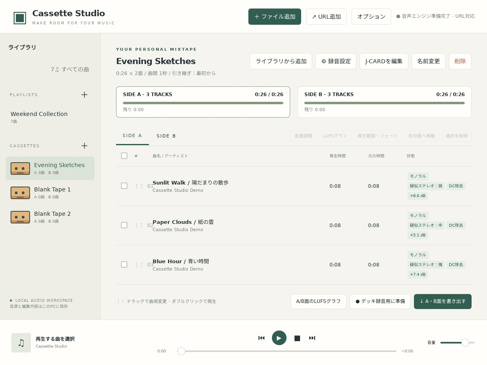

## 録音設定・時間・無音・フェード

### 設定を開く場所と適用範囲

カセットでは右ペインのタイトル横の「録音設定」を開きます。プレイリスト／「すべての曲」では「作成・取り込み設定」です。設定はプレイリスト・カセットごとに保存し、「すべての曲」の既定設定はその画面のブラウザ内に保存します。

曲ごとの手動音量・疑似ステレオは別の設定で、同じ音源を使う全リストに共通です。[音量・音質と解析](#audio)で説明します。

| 設定 | 内容 |
| --- | --- |
| テープ時間 | 46／60／74／80／90／120分・カスタム |
| 片面の長さ | 実際の分・秒を指定し、A/B両面に同じ長さを適用。旧データの補正済み時間も保持 |
| 各面先頭の無音 | 0.5秒刻み、初期値0秒。録音時間に含める |
| 曲間・フェード | 0.5秒刻み |
| 余白の基準 | 残り時間がこの基準以上なら、未配置の曲で余白を埋める |
| 引き継ぎ | A面終端で切れた曲を、B面で最初から／続きからフェードイン |
| 無音とみなす音量 | 小さい値ほど静かな部分だけを無音と判定 |
| 無音の最小継続時間 | 指定時間以上続いた静かな部分を無音と判定。0.1秒刻み、初期値0.5秒 |
| 音量統一・DC除去 | 下の音声調整の説明を参照 |
| WAV形式 | DAT向けの16bit／48kHz・16bit／44.1kHz。未設定は16bit／44.1kHz |

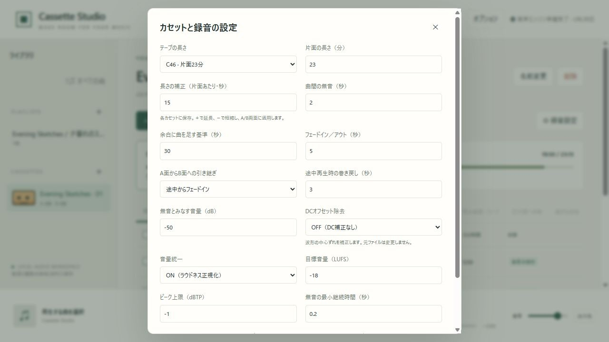

### 前後の無音と再解析

曲の先頭・末尾につながる無音だけを再生時間から除きます。音声全体を走査して判定するため、曲中の長い無音やその後に再開する音は保持します。

無音設定は新規取り込みに適用します。既存曲を更新する場合は対象曲を選び、**オプション → 選択曲の無音を再解析**を実行します。選択なしでは実行しません。カセットを削除する必要はありません。

全曲再生の項目は新しい長さに追従し、先頭・末尾に接する範囲も更新します。手動で指定した途中の位置は元音源上の位置を保ち、新範囲外の部分だけを詰めます。長さ0の項目は除外し、曲順は維持します。時間超過は警告し、既存WAVは再生成が必要です。

### フェードとA/B引き継ぎ

自動配置時、残り時間が余白の基準以上なら次の曲を使い、面の終わりに収まるよう短縮・フェードアウトします。A面で切れた曲はB面先頭へ置き、最初から再生するか、切れた位置からフェードインして続けるかを選べます。

引き継ぎ・余白設定は新しい配置に適用します。既存カセットを変える場合は再作成するか、再生範囲を編集してください。

### 再生範囲・フェードの自動設定

1曲選び、「再生範囲・フェード」を開いて「自動設定」を押します。収まる場合は指定開始位置から曲末までを復元してフェードを解除し、はみ出る場合は他の曲・曲間を考慮した残り時間に合わせて短縮・フェードアウトします。「適用」で保存します。

再生する長さは小数1桁・0.1秒刻みです。表示を丸めるだけでは保存済みの精密な長さを変更しません。0.5秒未満の短い断片にはフェードを付けません。

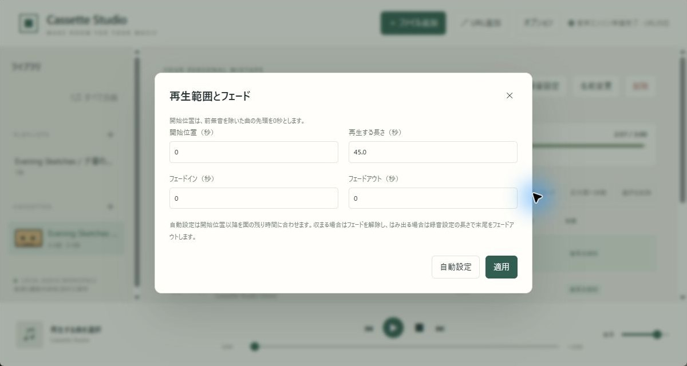

## 音量・音質と解析

### 音量統一とDCオフセット除去

| 項目 | 操作・仕様 |
| --- | --- |
| 音量統一 | 「録音設定」でON。曲全体の強弱を圧縮せず、一定の音量補正を適用 |
| 目標・ピーク | 初期値−18 LUFS・−1 dBTP。ピーク上限を優先し、目標に届かない場合は「ピーク制限」と表示 |
| DC除去 | 「録音設定」でON。無音除去後の曲全体の左右別の平均ずれを、音量・フェード処理前に差し引く |
| 初期状態 | 音量統一・DC除去ともOFF |
| 解析 | 新規取り込みで実行。既存曲も必要時に解析。「オプション」から測定だけを実行できる |

ピーク測定・PCM丸めのため0.1dBの余裕を持たせます。測定できない短い音源・無音の音源は自動増幅しません。DC除去後の音量・ピークは別に測定し、音量統一OFFでもDC除去ON時はピーク上限を守ります。

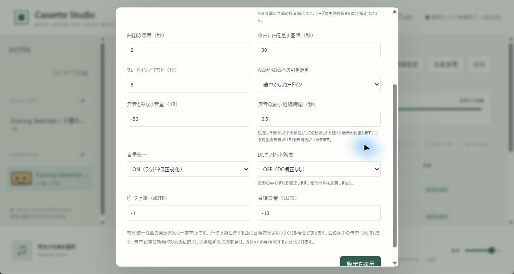

### 曲ごとの音量調整・疑似ステレオ

曲を1つ選び「音量調整」を開きます。

- 手動補正は−24〜＋24dB。音量統一ON時は自動補正に加算し、ピーク上限を超える増幅を抑えます。
- 疑似ステレオはOFF／弱／標準／強、初期値OFFです。1チャンネル、または音源全体の左右差が十分小さい2チャンネルだけが対象で、ステレオ・逆相・多チャンネル音源では選択できません。
- 状態欄に「モノラル／MONO」と「疑似ステレオ：弱・中・強」を表示します。既存曲の未判定データは起動後にバックグラウンドで確認・保存します。
- 「保存して試聴」で処理結果を確認できます。手動補正と疑似ステレオは、その音源を使う全プレイリスト・カセットに共通適用します。

音量・DC・疑似ステレオは試聴、録音用再生、WAV出力で共通の処理を使い、LUFSグラフにも反映します。B面への引き継ぎも元の曲全体の測定値を使います。元ファイルは変更せず、設定変更後はWAVを再生成してください。DC除去は一定の平均ずれの補正で、デッキの録音バイアス調整ではありません。

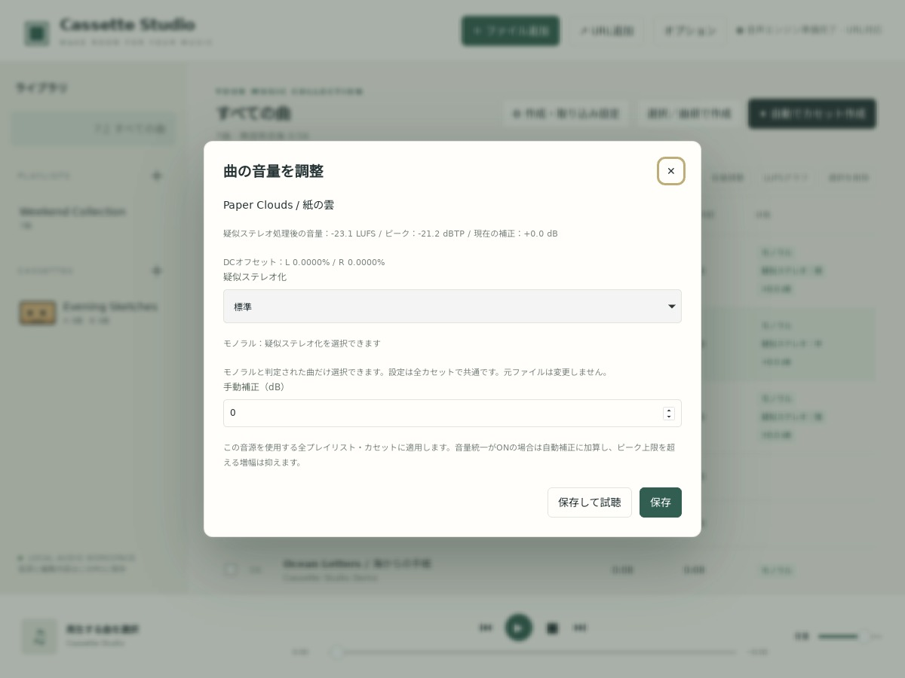

### LUFSグラフで確認する

- **曲単位**：1曲選択して一覧上部の「LUFSグラフ」を押します。カセット内では再生範囲とフェードも反映します。
- **面全体**：カセットを選び、下部の「A/B面のLUFSグラフ」を押します。SIDE A／Bを切り替えられます。
- Short-term（3秒）とMomentary（400ms）、処理前後の推移、目標線、LUFS・トゥルーピークを表示します。音量統一OFFでも目標線は表示します。
- 面全体には先頭・曲間・末尾の無音、曲の開始位置・名前を含みます。灰色は音量・DC・疑似ステレオ補正前、緑は録音設定適用後です。
- 測定窓が不足する先頭や無音は空白になります。グラフは0.5秒間隔で、最大24時間の曲に対応します。
- 初回の面解析には一時WAV用の空き容量と時間が必要です。一時WAVは削除し、解析結果を`loudness-graphs`へ保存して再利用します。出力機器・デッキ側の音量は測定しません。

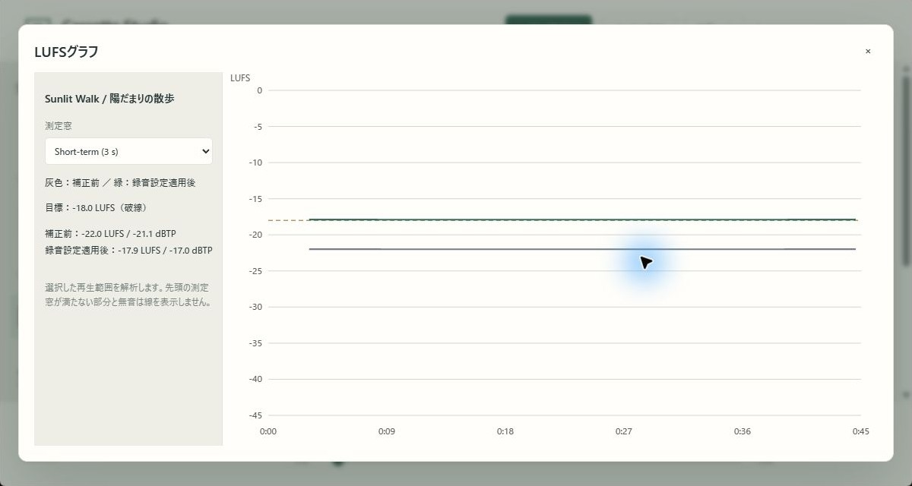

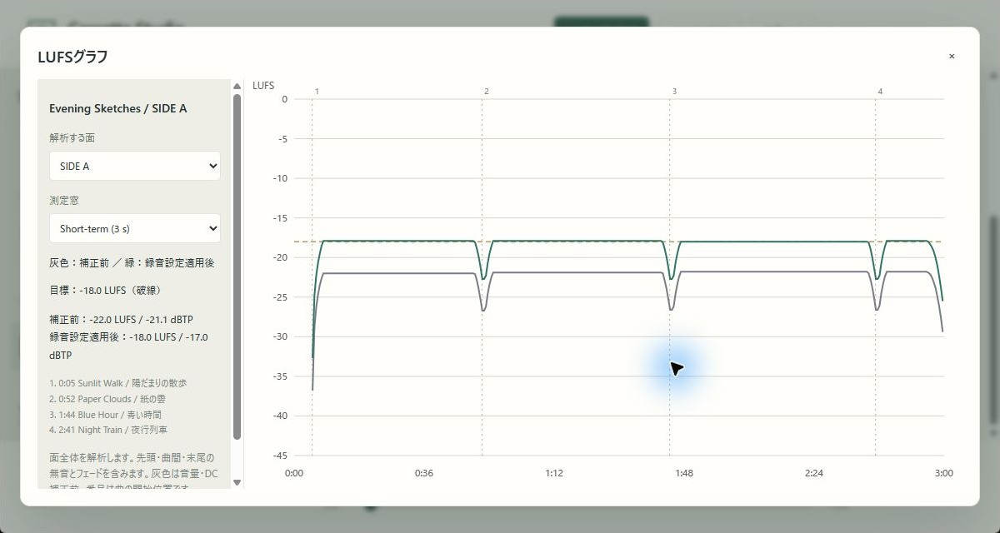

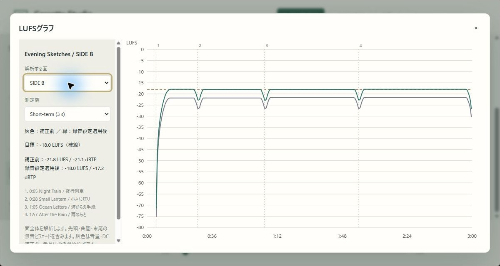

## 再生・デッキ録音・WAV出力

### 試聴と出力先

下部で再生・一時停止・停止・曲送り・シーク・音量調整を行います。出力先の選択と切り替えに対応する環境だけ「出力先」を表示し、それ以外はOSの音声設定を使います。出力先の選択はWAV生成には影響しません。

カセットは書き出しと同じ音声を準備してから再生し、曲間・フェードを一致させます。A面終了で停止するので、テープを裏返してB面を開始します。

### 基準音で録音レベルを合わせる

1. PCの音声出力をデッキの録音入力へ接続します。
2. **オプション → 基準音**で400Hz／1kHz、ピーク−30〜−3dBFSを選びます。初期値は400Hz・−12dBFSです。
3. 基準音を再生し、デッキ側の録音レベルを0dBへ合わせます。
4. 停止または画面を閉じて基準音を止め、PC側の音量とデッキのレベルを変えずに録音します。

曲と同じ出力先・再生音量を使い、60秒でも自動停止します。デッキの0dBとデジタルのdBFSは別の基準なので、曲のピークが必ず0dBになる機能ではありません。Dolbyの校正でもありません。

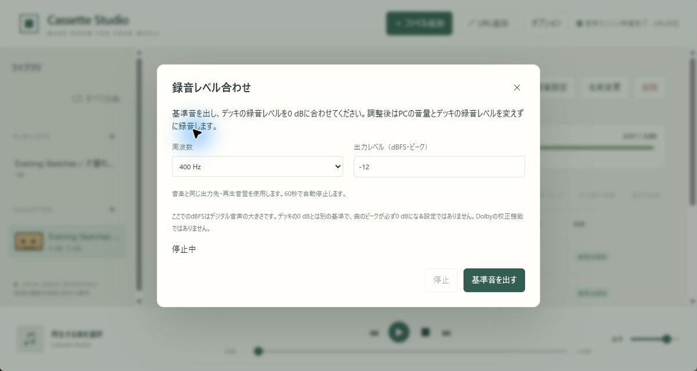

### デッキへ録音する

「デッキ録音用に準備」で現在の面を準備します。デッキで録音を開始し、「再生開始」または「5秒後に再生開始」を選びます。待機中も直ちに開始できます。デッキのハードウェア録音ボタンを直接操作する機能ではありません。

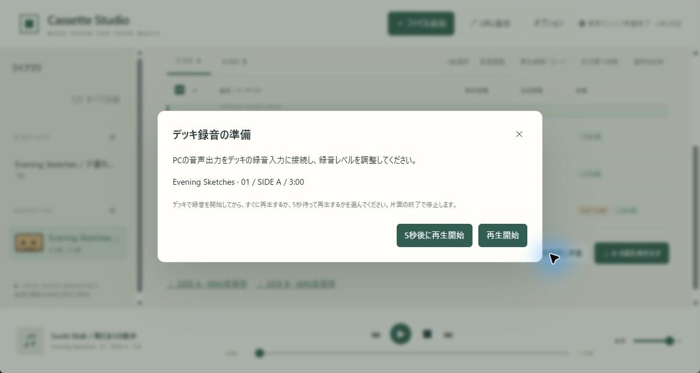

### WAVを保存する

A/B各面を16bitステレオWAVで生成し、末尾を無音で埋めて指定した片面長にします。録音設定のDAT向けWAV形式は44.1kHz／48kHz、未設定は44.1kHzです。元ファイルや曲単体の試聴形式、録音機器自体の設定は変えません。

WAV保存リンクは生成したカセットを選んでいる間だけ表示します。曲や設定を編集すると無効になるので、再生成してください。

## オプションと言語

「オプション」は画面上部にあります。

| 項目 | 内容・対象 |
| --- | --- |
| 基準音 | デッキ録音レベル用。操作手順は上の録音の章 |
| 選択曲の音量・DC解析 | 選択曲、未選択なら表示中の全曲を測定。再生範囲は保持し、補正ON/OFFは録音設定で指定 |
| 選択曲の無音を再解析 | 選択した音源だけを現在の無音設定で再解析し、既存ミックスへ反映。選択なしでは実行しない |
| 言語 | 日本語／英語。初回は動作環境が日本語なら日本語、それ以外は英語。手動選択は次回も保持 |

音量・DCの測定と無音の再解析は別の操作です。保存・解析の通知は開いている画面の手前に表示します。ユーザーが付けた曲名などは翻訳しません。

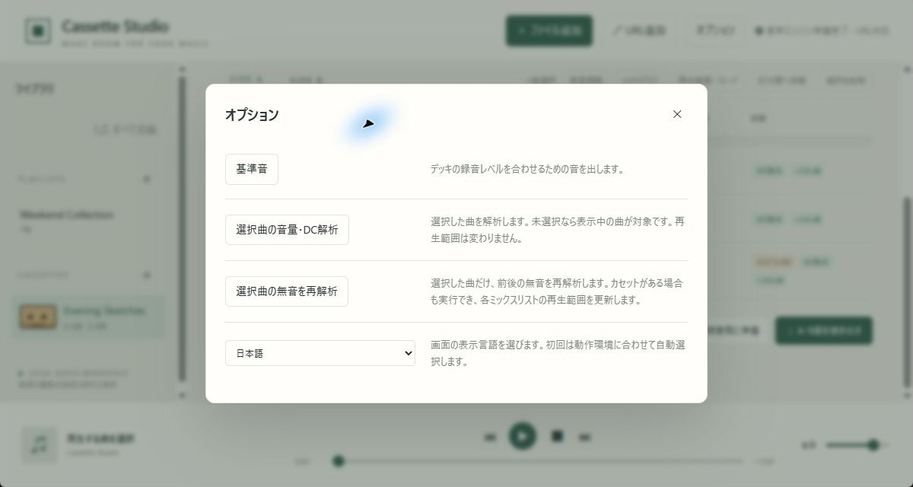

## 保存先とバックアップ

| 形式 | 保存先 |
| --- | --- |
| Windows配布ZIP | 展開フォルダー内の`data`（`portable.txt`で指定） |
| 通常インストール版 | OSのアプリ用データ領域。WindowsはLocalAppData配下、Linuxは通常`~/.local/share/cassettestudio` |
| Flatpak | `~/.var/app/io.github.syouth2002.CassetteStudio/data/cassette-studio-flatpak/` |
| AppImage | `~/.local/share/cassette-studio-appimage/`。`XDG_DATA_HOME`指定時はその配下 |
| 開発中 | プロジェクトの`data/library.json`があれば、その`data`を使用 |

主な内容は`library.json`（登録情報）、`sources`（取り込んだ音源）、`jcards`（J-CARD）、`preview`（試聴用）、`exports`（WAV）、`loudness-graphs`（解析キャッシュ）です。WebViewの設定も同じ保存場所を使います。

**バックアップはアプリを終了してから保存フォルダー全体をコピー**します。不要な試聴用・書き出し用ファイルは終了後に削除できます。カセットを削除してもJ-CARDファイルは保持しますが、そのカセットからは開けなくなります。

Flatpak／AppImageで既存データを試す場合は、両アプリを終了し、空の移行先に`library.json`・`sources`・必要なら`jcards`をコピーします。元の保存先を残し、WebViewプロファイルやロックファイルはコピーしません。解析キャッシュは再生成できます。自動での移行・共有は行いません。同じライブラリの同時起動は拒否します。

## ブラウザ利用と未実装の機能

ブラウザ画面も同じPC上の音声エンジンを使います。既定の接続先は`http://127.0.0.1:3210/`で、外部公開サーバーやブラウザ単体のWASM版は含みません。専用ウィンドウを閉じると内蔵エンジンも終了します。初回セットアップ後、URL取り込み以外のローカル操作にはネット接続は不要です。

Dolby B/C互換のエンコード・デコードは未実装です。[調査資料](dolby-b-c-research.ja.md)を参照してください。開発・実行設定は[開発者向けガイド](development.ja.md)にまとめています。
