# 使い方・機能の仕様

[トップ](../README.ja.md) · [導入](installation.ja.md) · [J-CARD](jcard.ja.md) · [English](usage.md)

## 1. 音源を取り込む

上部の「ファイル追加」、音楽・動画のD&D、または「URL追加」を使います。動画は最初の音声ストリームを使用します。URL取り込みはローカルへ保存し、再利用します。同じ内容のファイルは名前が違っても重複登録しません。yt-dlp対応サイトの単一音声・動画が対象で、DRMやログイン必須のコンテンツ、プレイリスト一括取り込みは対象外です。

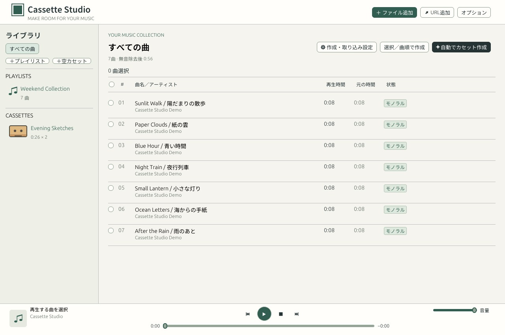

左ペインで「すべての曲」、プレイリスト、カセットを選択します。右ペインの曲名・アーティストは左寄せです。状態欄は短いバッジで表示し、詳細は右クリックの「プロパティ」で確認できます。取り込み中は処理内容を表示し、終了・エラーも明示します。

## 2. 曲の情報・解析・編集

曲を右クリックすると、再生、音量調整、LUFSグラフ、選択曲の音量・DC解析、選択曲の無音再解析、プロパティ、削除を選べます。複数選択時の解析・削除は選択曲だけが対象です。モノラル曲の調整項目は「音量調整・疑似ステレオ」に統合しています。

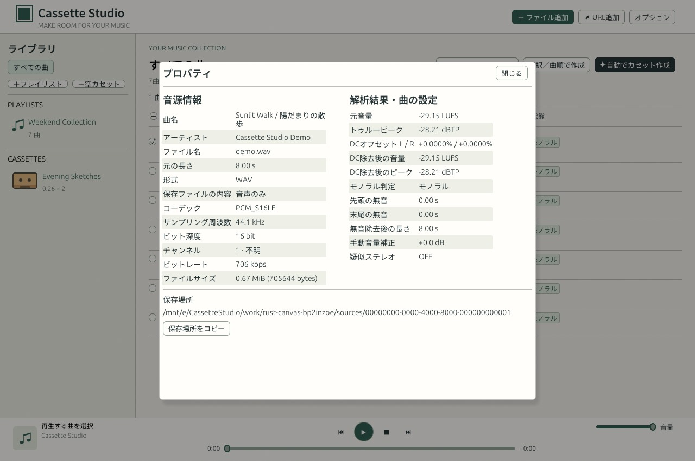

プロパティには取得可能なコンテナ・コーデック、サンプリングレート・ビット深度・チャンネル数、タグ、保存情報、無音範囲、ラウドネス・ピーク・DCなどをまとめます。圧縮形式ではPCMのビット深度と同じ意味の値を出しません。MP4/M4A系の共通コンテナ名は、実際に取得できたブランド・映像の有無に基づいて表示します。

無音再解析は前後の無音だけを対象にし、末尾から逆方向に調べます。曲中の意図した無音で後半を切りません。再生長が変わった場合は関連するミックスリストへ反映します。文字コード補正は復元可能なShift_JIS／CP932等の誤読に対応し、既に失われた文字は復元できません。

## 3. カセットを作る

- 「選択／曲順で作成」は一覧の曲順を優先します。未選択なら全曲が候補です。
- 「自動でカセット作成」は既存カセットに収録済みの曲を候補から除外します。空カセットがあれば配置先を選び、それぞれの録音時間に合わせて重複なく配分します。
- 左ペインの「＋空カセット」で先に器を作り、録音設定を保存しておくこともできます。
- 名前の初期候補は番号付きで生成します。名前欄はURL入力と同じ大きい入力欄です。

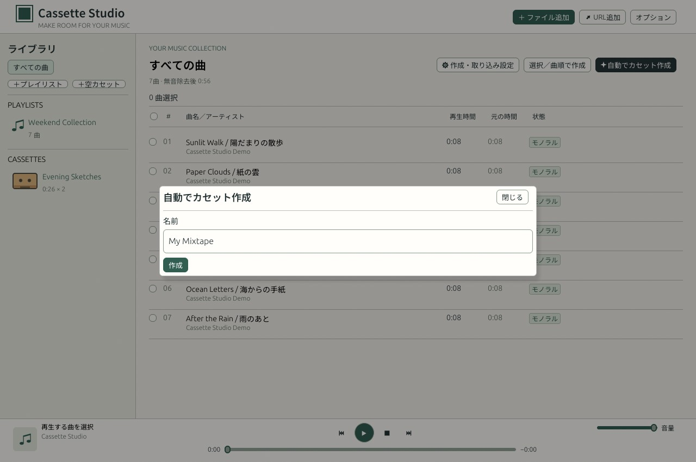

曲の追加・削除・ドラッグ／上下ボタンで曲順を編集できます。ドラッグ中は曲名と挿入位置を表示し、上下端では自動スクロールします。曲順変更後の完了ポップアップは出しません。すべての曲の並び順は変更できません。

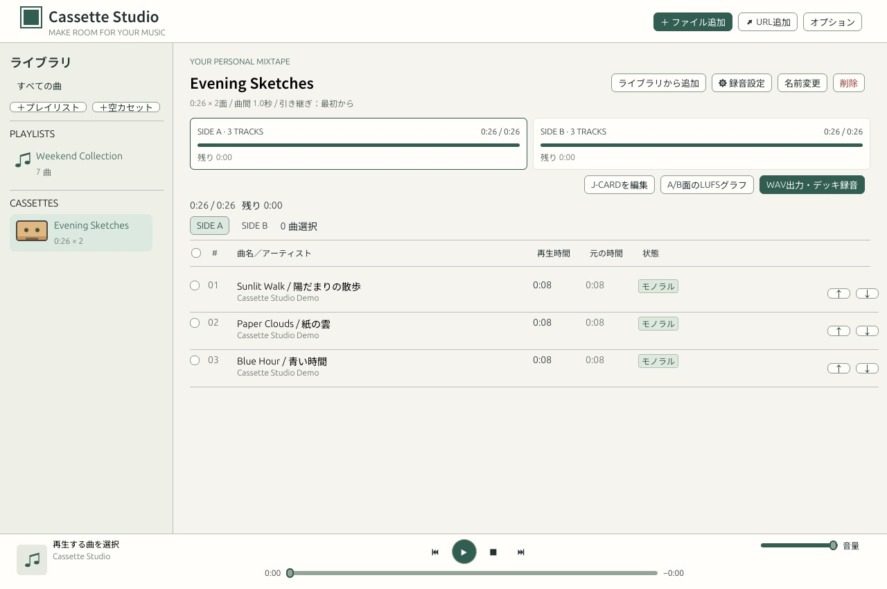

## 4. 録音設定

カセット右上の「録音設定」はそのカセット専用です。「作成・取り込み設定」は新規作成・取り込みの既定値です。テープは46／60／74／80／90／120分・カスタムから選択し、片面長は分・秒で指定します。

曲間、A/B面先頭の無音、フェード、音量統一・目標LUFS・ピーク上限・DC除去、無音判定、WAV形式などを設定できます。曲間・先頭無音・フェードは0.5秒刻み、無音の最小継続時間は0.1秒刻みで初期値0.5秒です。WAV形式は未設定／16bit 48kHz／16bit 44.1kHzで、DATへ渡す用途も想定しています。

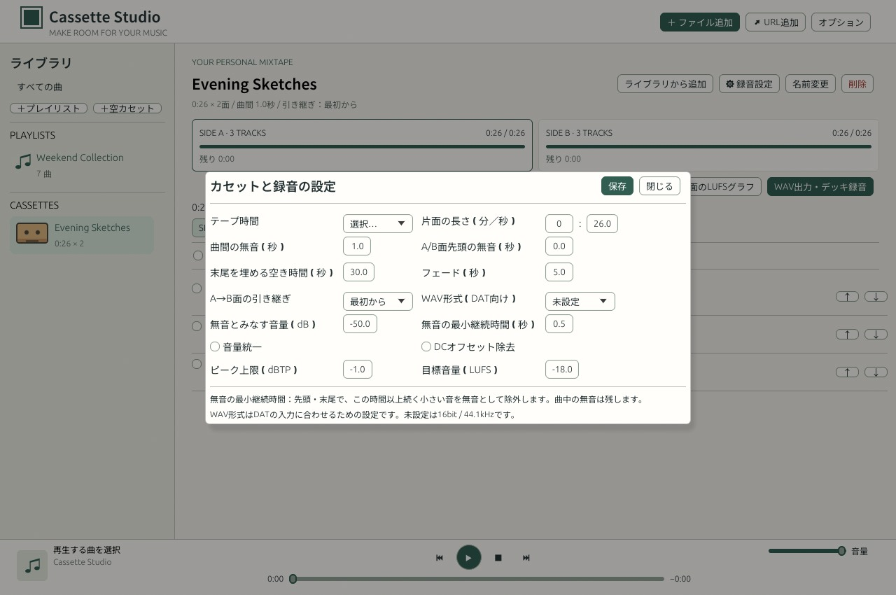

長さを超える曲は設定に従ってフェードし、A面からの引き継ぎはB面で最初から再生するか、途中からフェードインするかを選べます。手動で多くの曲を追加したときもB面へ配置します。曲の右クリック→「再生範囲・フェード」の「自動設定」は残り時間に合わせ、収まる場合は不要なフェードを解除します。再生する長さは0.1秒単位で表示します。

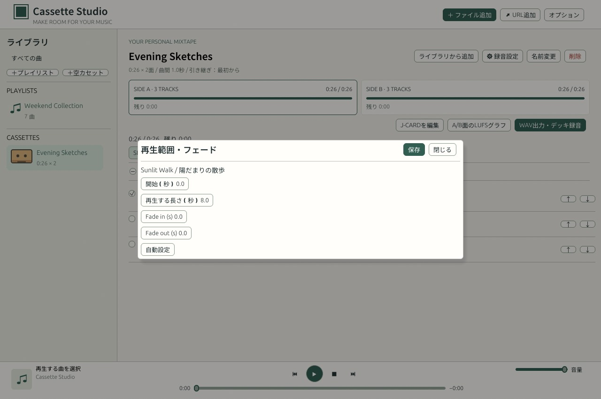

## 5. 音量・音質とLUFS

音量統一は解析値とピーク上限を使って補正し、手動ゲインも指定できます。DC除去、モノラル判定・疑似ステレオは共通の音源データに保持します。疑似ステレオはOFF／弱／中／強を選択し、状態欄にも強さを表示します。強い設定ほど広がりと音色変化が大きくなります。ダイアログ内で試聴・停止できます。

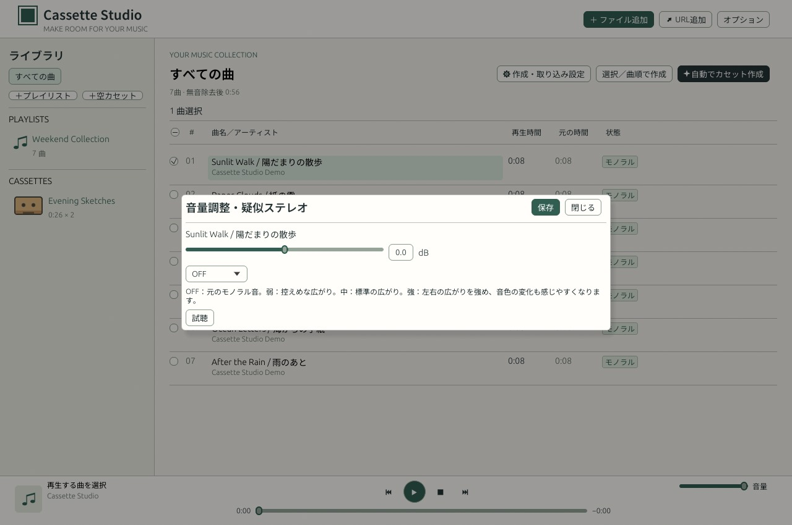

単曲とA/B面全体のLUFSグラフを表示できます。元データは赤い点線、補正後は別の線で表示します。解析中は進行中であることを表示し、曲単位の解析済みデータを再利用します。実際の範囲・フェード・曲間を含む面全体の解析は、その出力条件の結果を使います。

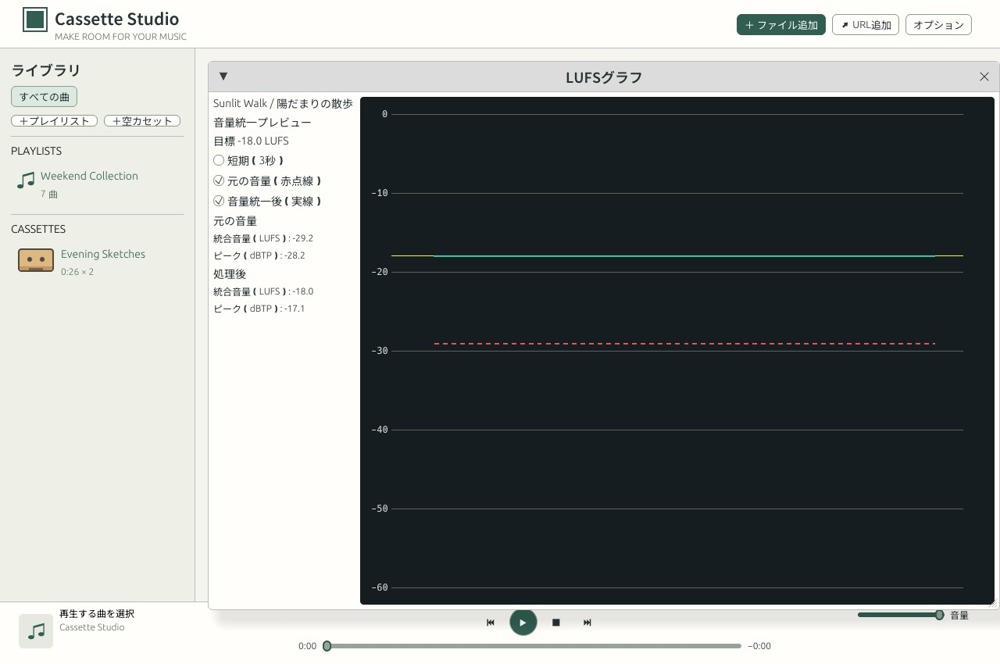
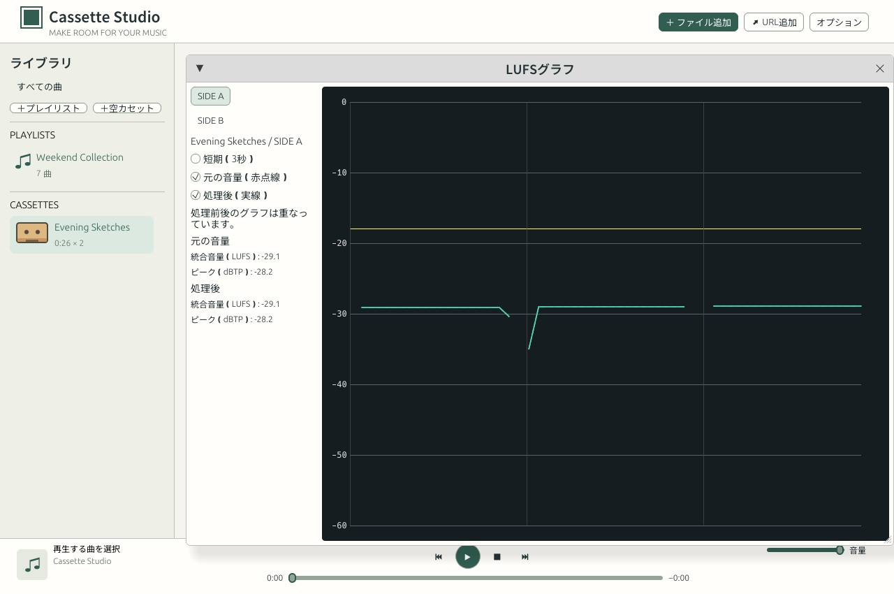

## 6. 通常再生と録音専用モード

下部が通常再生のコントロールです。曲のダブルクリック・右クリック再生も元のリストと位置を保持します。1曲選択時はその曲からリストを再生し、複数選択時は選択した順序のキューを使います。前／次は前後の曲へ移動し、別のライブラリを閲覧しても再生順序は変わりません。

カセットの通常再生でWAV生成・読み込みが必要な場合は「再生データを準備」ダイアログを表示します。準備完了時に自動で閉じて再生します。閉じて取り消した場合は後から再生しません。

「WAV出力・デッキ録音」はA/B面のWAV保存と録音専用モードをまとめた画面です。曲順・範囲・音声設定・解析値などが変わっていなければ、生成済みWAVを再利用します。カセット名だけの変更は再生成しません。アプリ再起動後は必要に応じて再生成します。

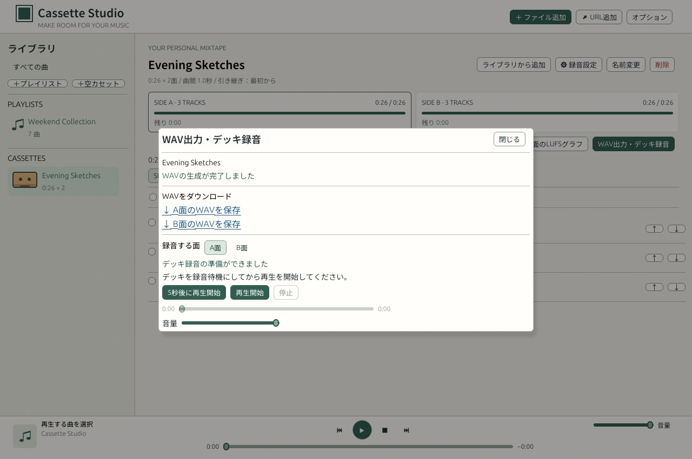

この画面でA面／B面を選び、再生・一時停止・停止・シーク・音量と「5秒後に再生開始」を操作できます。録音側はメインのプレーヤーから独立しています。開く際に通常再生を止め、閉じると録音用の再生と開始待ちも停止します。WAVはA/B面別のリンクから保存でき、保存結果も同じ画面に表示します。

## 7. オプション・保存・ブラウザ利用

オプションは基準音と言語設定です。基準音で出力経路の音量を固定し、デッキ側の録音メーターを0dBへ合わせます。言語は自動／日本語／英語を選べ、自動では日本語環境だけ日本語になります。曲の解析は右クリックメニューから実行します。

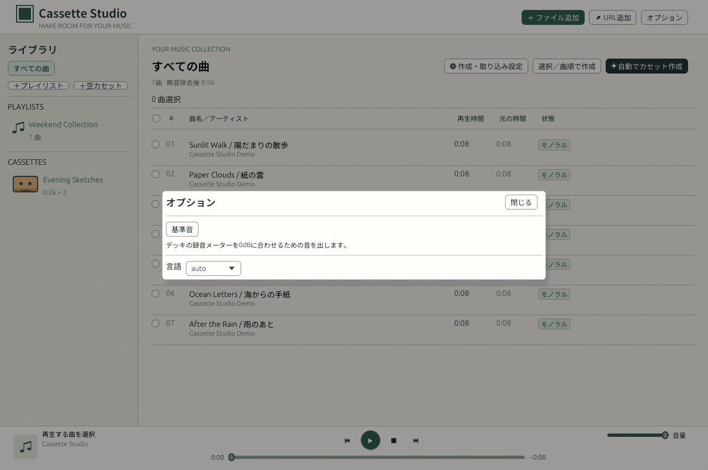

ライブラリ・取り込み済み音源・J-CARDはアプリのデータフォルダーへ保存します。バックアップはフォルダー全体をコピーしてください。従来版・Flatpak・AppImageの保存先は別で、同居できます。保存先の詳細は[導入ガイド](installation.ja.md)を参照してください。

ブラウザ版も同じRust UIですが、ローカル音声エンジンが必要です。ブラウザ単体でFFmpegを動かす方式ではありません。出力デバイス選択は対応するデスクトップ版だけに表示します。Dolby B/C互換エンコーダーは未実装です。
