# User guide and feature specifications

[Home](../README.md) · [Installation](installation.md) · [日本語](usage.ja.md)

This guide follows the workflow from importing media to recording. Case-insert design is covered in the [J-CARD guide](jcard.md).

## Contents

- [The workspace](#workspace)
- [Import and library management](#import)
- [Create and arrange cassettes](#cassettes)
- [Recording settings, duration, silence and fades](#recording-settings)
- [Audio adjustment and analysis](#audio)
- [Playback, deck recording and WAV export](#output)
- [Options and language](#options)
- [Storage and backup](#storage)
- [Browser mode and unimplemented features](#browser)

## The workspace

Choose All tracks, a playlist or a cassette in the left pane; edit its track list in the right pane. The sidebar is a text list with small cassette icons.

| Area | Controls |
| --- | --- |
| Top row | Add files, Add URL, Options |
| Right-pane heading | Creation/import settings and cassette creation; on a cassette: Add from library, Recording settings, Rename, Delete |
| Track list | Selection, loudness adjustment, LUFS graph, deletion; on cassettes: A/B sides, range/fades, move to opposite side |
| Bottom | Playback, previous/next, seek, volume, deck preparation, WAV generation |

Double-click a track to play. Side tabs, editing controls and column headings remain visible while scrolling.

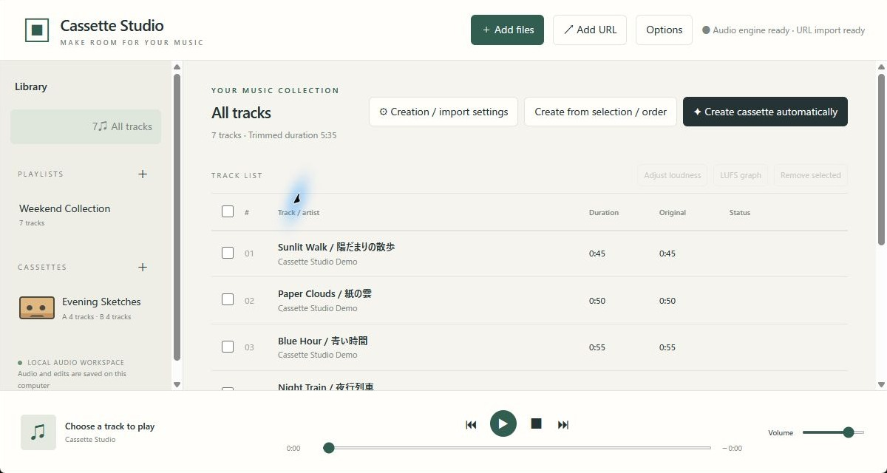

## Import and library management

### Files and URLs

- Use **Add files** or drag/drop audio/video. Videos use the first audio stream.
- **Add URL** imports individual items supported by yt-dlp. Playlist expansion, DRM and sign-in-required content are not supported; site changes may prevent downloads.
- Identical file bytes reuse an existing source even with a different filename. Different formats, tags or versions are distinct sources. Importing media into a playlist/cassette also avoids inserting that same source twice.
- Imported media are copied to the app's data folder. Original files remain unchanged.

### Playlists and deletion

Use sidebar + buttons to create playlists or empty cassettes. Playlist/cassette entries can be added, removed and reordered. All tracks cannot be reordered.

**Remove selected** in All tracks removes registrations and their references from every playlist/cassette after confirmation. Original files and imported copies are retained. Removing an entry from a playlist affects that list only.

### Legacy tag recovery

Some Shift_JIS/CP932 tags misread as Latin-1 can be repaired when the original text is recoverable. Correct Unicode and Western tags are preserved. Before repairing an existing library, metadata are backed up as `library-before-tag-repair.json`. This is targeted recovery, not universal encoding detection; characters already replaced by question marks cannot be restored.

## Create and arrange cassettes

### Manual creation

1. Open All tracks or a playlist and select candidates. With no selection, the displayed list is used.
2. Set the side duration and other defaults in **Creation / import settings**.
3. Choose **Create from selection / order** and enter a name. Current order is prioritized.

Suggested mix names are numbered to avoid existing names. Manual creation can reuse tracks recorded on other cassettes.

### Automatic creation and prepared empty tapes

**Create cassette automatically** excludes tracks already recorded on either side of any existing cassette, including selected candidates. If no playable unrecorded tracks remain, a message is shown.

- **No empty cassettes**: creates a new cassette using the current settings.
- **Empty cassettes exist**: opens destination selection and fills them in order using their saved settings, without reusing a track across tapes.
- Prepare empty tapes with the CASSETTES + button, then save each tape's duration, gaps and other settings.
- From a playlist/All tracks, selected entries are candidates; without a selection, the displayed list is used. Starting from an empty cassette uses the full library.
- Filled cassettes are never overwritten. Destinations that cannot receive tracks remain empty, and unplaced counts are reported.

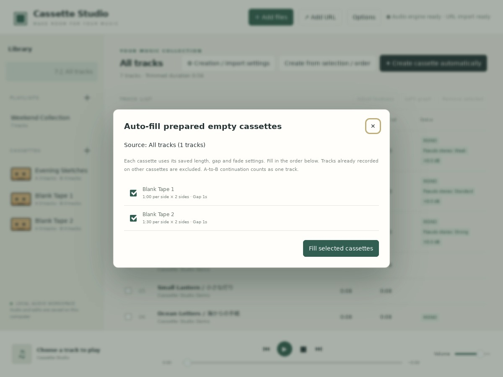

Exclusion uses source track IDs, not title matching: separately encoded or tagged copies remain distinct. An A-to-B continuation counts as one track. The planner searches at 0.1-second resolution and completes A first; it does not guarantee a global optimum across all sides or cassettes.

### Editing and capacity

Use **Add from library**, reorder, remove or move tracks to the opposite side. Manual additions that exceed capacity are shortened and faded to fit; entries with no available space are skipped. Manual additions do not automatically create B-side continuations.

If later edits exceed capacity, move/remove entries or use the range/fade Auto fit described below.

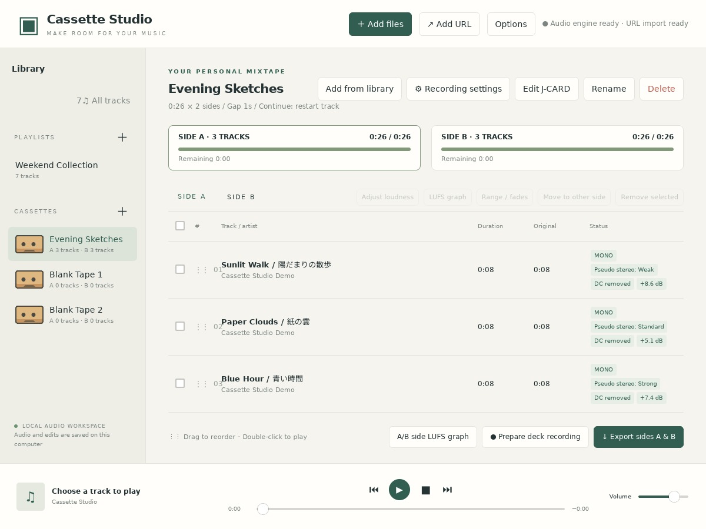

## Recording settings, duration, silence and fades

### Location and scope

Use **Recording settings** beside a cassette title. Playlists and All tracks show **Creation / import settings**. Settings are saved per playlist/cassette; All tracks defaults are stored in that browser/WebView.

Manual gain and pseudo stereo are separate per-source settings shared by all uses of the track; see [audio adjustment and analysis](#audio).

| Setting | Specification |
| --- | --- |
| Tape length | 46/60/74/80/90/120 minutes or custom |
| Per-side duration | Actual minutes/seconds; the same duration for A and B. Older corrected durations are retained |
| Leading silence | 0.5-second steps, default zero; included in tape capacity |
| Gaps and fades | 0.5-second steps |
| Fill threshold | Fill sufficiently large remaining space with an unplaced track |
| Continuation | Restart the cut A-side track on B, or resume at the cut with a fade-in |
| Silence threshold | Lower values classify only quieter sections as silence |
| Minimum silence duration | Quiet audio must last this long to count as silence; 0.1-second steps, default 0.5 seconds |
| Normalization / DC removal | Explained in the audio section below |
| WAV format | DAT-oriented 16-bit/48 kHz or 16-bit/44.1 kHz; Unspecified keeps 16-bit/44.1 kHz |

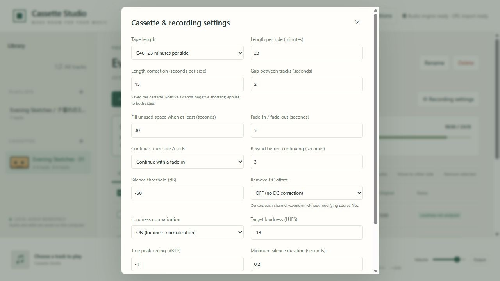

### Boundary silence and reanalysis

Only silence connected to the source's beginning or end is trimmed. The full decoded audio is scanned, preserving intentional internal pauses and later audio.

Silence settings apply to new imports. To update existing sources, select tracks and choose **Options → Reanalyze silence in selected tracks**. No selection means no reanalysis. Existing cassettes need not be deleted.

Whole-track entries follow the new audible length. Boundary-anchored entries follow the new boundaries; manually selected interior positions retain their original source positions and are clipped only where necessary. Zero-length entries are removed, order is retained and overcapacity is reported. Existing WAVs need regeneration.

### Fades and A/B continuation

During automatic arrangement, when remaining room meets the fill threshold, an unplaced track can be shortened and faded at the side's end. A track cut on A is placed first on B, either restarting or resuming at the cut with a fade-in.

Fill/continuation changes apply to new arrangements. Recreate or edit ranges to change an existing cassette.

### Range / fades Auto fit

Select one entry, open **Range / fades** and press **Auto fit**. If the remaining source fits, it restores the length from the selected offset to the end and clears both fades. If it overflows, it accounts for other entries/gaps and trims/fades to available capacity. Press **Apply** to save.

Playback length is shown to one decimal place and edited in 0.1-second steps; display rounding alone preserves existing precision. Fragments shorter than 0.5 seconds receive no fade.

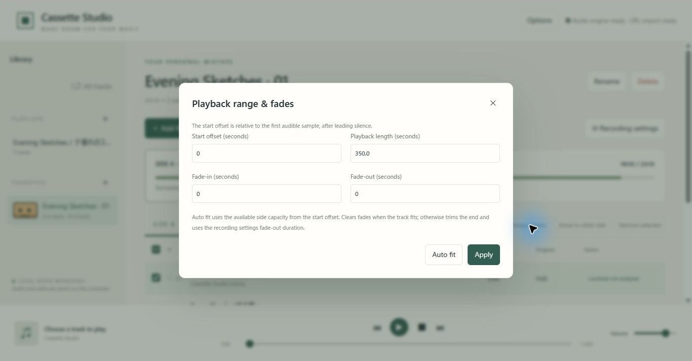

## Audio adjustment and analysis

### Normalization and DC removal

| Setting | Operation |
| --- | --- |
| Normalization | Enable in Recording settings; constant gain preserves within-track dynamics |
| Target and peak | Defaults: −18 LUFS, −1 dBTP. Peak ceiling takes priority; the UI indicates peak limiting |
| DC removal | Enable in Recording settings; subtracts each channel's mean over the trimmed track before gain/fades |
| Initial state | Normalization and DC removal are OFF |
| Measurement | Performed for new imports and when needed for older tracks; Options can measure without enabling corrections |

A 0.1 dB margin covers peak measurement/PCM rounding. Unmeasurable short or silent audio is not automatically amplified. DC-corrected loudness/peak are measured separately, and its peak ceiling is enforced even with normalization off.

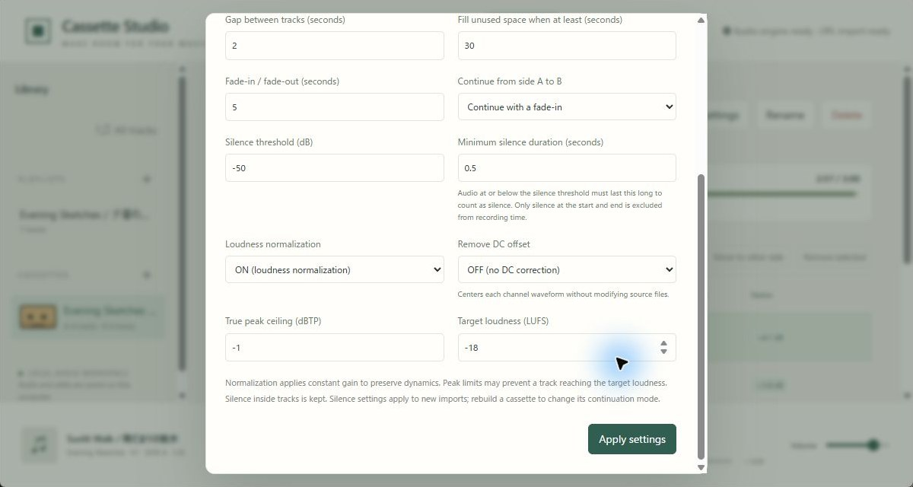

### Per-track gain and pseudo stereo

Select one track and open **Adjust loudness**.

- Manual gain is −24 to +24 dB. With normalization ON, it is added to automatic gain and constrained by the peak ceiling.
- Pseudo stereo offers OFF/Weak/Standard/Strong, initially OFF. Only single-channel audio or two-channel audio with negligible full-source difference qualifies. Stereo, antiphase and multichannel sources cannot enable it.
- Status badges show MONO and pseudo stereo strength. Existing unclassified tracks are checked and saved in the background after startup.
- **Save and audition** previews the result. Gain and pseudo stereo apply to every playlist/cassette using that source.

Preview, deck playback, WAV export and LUFS graphs use the same audio processing. Continued tracks retain whole-source measurements. Originals remain unchanged; regenerate WAVs after changing settings. DC removal corrects a constant offset and is not a deck recording-bias adjustment.

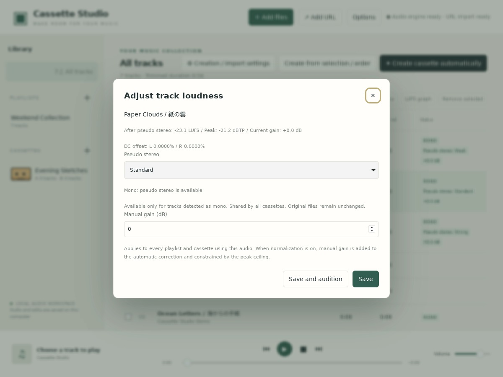

### LUFS graphs

- **Track**: select one entry and choose the list's **LUFS graph**. Cassette ranges/fades are included.
- **Whole side**: choose **A/B side LUFS graph** on a cassette, then switch SIDE A/B.
- Compare Short-term (3 seconds), Momentary (400 ms), original/processed curves, target level, integrated LUFS and true peak. The target line remains visible with normalization OFF.
- Whole-side graphs include leading/inter-track/trailing silence and track markers. Gray is before gain/DC/pseudo-stereo processing; green applies recording settings.
- Incomplete initial measurement windows and silence appear as gaps. Points are spaced by 0.5 seconds; tracks up to 24 hours are supported.
- Initial whole-side measurement requires time and temporary WAV space. That WAV is removed; results in `loudness-graphs` are reused. Device/deck volume is outside these measurements.

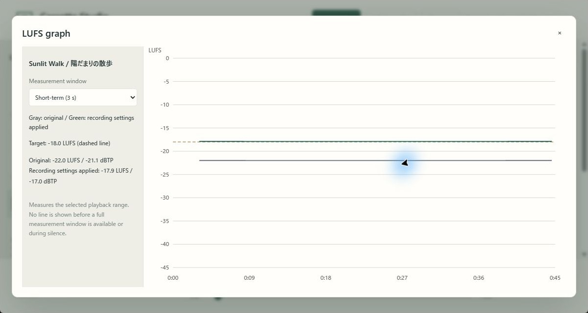

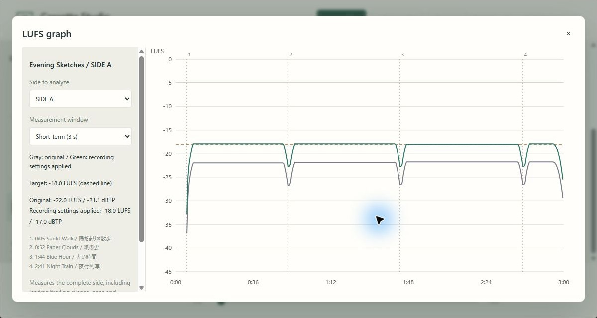

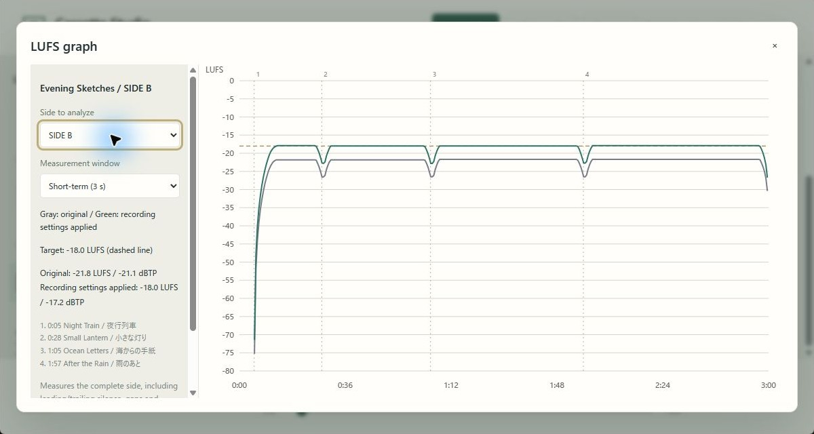

## Playback, deck recording and WAV export

### Audition and output device

The bottom bar provides playback, pause, stop, track navigation, seek and volume. **Output** appears only where selection and switching are supported; otherwise use OS audio settings. Output selection does not affect generated WAVs.

Cassette playback prepares the same audio as export, preserving gaps/fades. A stops at its end; turn the tape over and start B separately.

### Match recording level with a reference tone

1. Connect PC audio output to the deck's recording input.
2. Choose **Options → Reference tone**: 400 Hz/1 kHz, −30 to −3 dBFS peak; defaults are 400 Hz/−12 dBFS.
3. Play the tone and set the deck's recording level to 0 dB.
4. Stop or close the tone dialog, then record without changing PC volume or deck level.

The tone uses music's output device/volume and stops automatically after 60 seconds. Deck 0 dB and digital dBFS are different references; this does not guarantee music peaks at deck 0 dB or provide Dolby calibration.

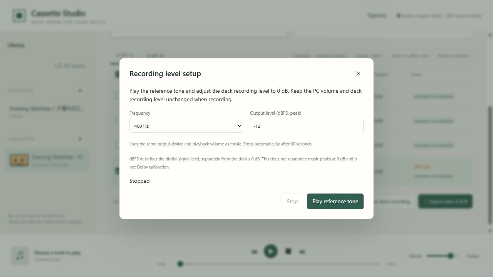

### Record to a deck

**Prepare deck recording** prepares the current side. Start recording on the deck, then choose immediate playback or the five-second countdown. You can start immediately during the countdown too. The app does not operate the hardware recording button.

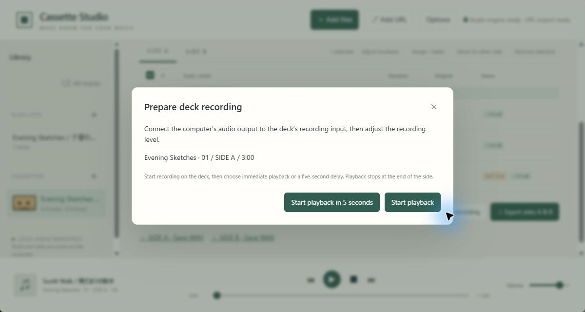

### Save WAV files

Generate 16-bit stereo WAVs for A and B, padded with silence to the specified per-side length. DAT-oriented formats are 44.1/48 kHz; Unspecified keeps 44.1 kHz. This does not change original files, individual-track preview formats or recorder hardware settings.

Save links appear only for the cassette that generated them. Editing contents/settings invalidates the links; regenerate the WAVs.

## Options and language

Options is in the top row.

| Control | Scope |
| --- | --- |
| Reference tone | Deck recording-level adjustment; steps are in the recording section above |
| Analyze loudness / DC in selected tracks | Selected tracks, or the displayed list if none are selected; preserves ranges and does not itself enable correction |
| Reanalyze silence in selected tracks | Selected sources only, using current silence settings; updates existing mixes; no selection means no work |
| Language | Japanese or English. Initially Japanese for a Japanese environment, otherwise English; manual choices persist |

Loudness/DC measurement and silence reanalysis are separate. Save/analysis messages stay in front of open dialogs. User-provided titles are not translated.

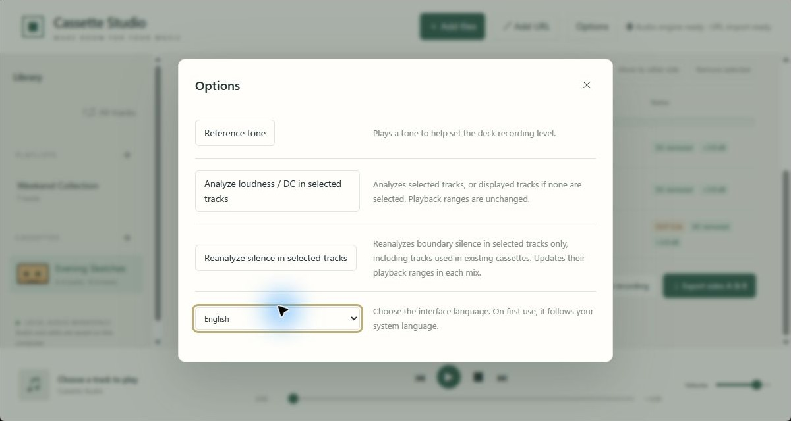

## Storage and backup

| Format | Location |
| --- | --- |
| Windows portable ZIP | `data` in the extracted folder, selected by `portable.txt` |
| Native installed app | OS app data: LocalAppData on Windows, normally `~/.local/share/cassettestudio` on Linux |
| Flatpak | `~/.var/app/io.github.syouth2002.CassetteStudio/data/cassette-studio-flatpak/` |
| AppImage | `~/.local/share/cassette-studio-appimage/`, or below the configured `XDG_DATA_HOME` |
| Development | Existing project `data` when `data/library.json` is present |

Contents include `library.json` (registrations), `sources` (imported copies), `jcards`, `preview`, `exports` and `loudness-graphs`. WebView preferences use the same storage root.

**Close the app and copy the whole data folder to back it up.** Unneeded previews/exports can be removed while closed. Deleting a cassette retains its artwork file, but that deleted cassette can no longer open it.

To try an existing library in Flatpak/AppImage, close both apps, copy `library.json`, `sources` and optionally `jcards` into an empty destination and keep the original. Do not copy WebView profiles or locks. Analysis caches can be regenerated. There is no automatic migration/sharing; simultaneous use of one library is blocked.

## Browser mode and unimplemented features

The browser interface uses the audio engine on the same PC, normally `http://127.0.0.1:3210/`. There is no public hosting server or browser-only WASM version. Closing the desktop window stops its embedded engine. After initial setup, local work other than URL import does not need internet access.

Dolby B/C-compatible encoding/decoding is not implemented; see the [research report](dolby-b-c-research.ja.md). Build and execution configuration are in the [development guide](development.md).
