# Usage and behavior

[Home](../README.md) · [Installation](installation.md) · [J-CARD](jcard.md) · [日本語](usage.ja.md)

## 1. Import media

Use Add files, drag audio/video files onto the application, or Add URL. Video imports use the first audio stream. Imported files and URL downloads are stored locally. Matching file content is not registered twice, even if its filename differs. URL import supports individual yt-dlp sources; DRM, required login and playlist expansion are outside this feature.

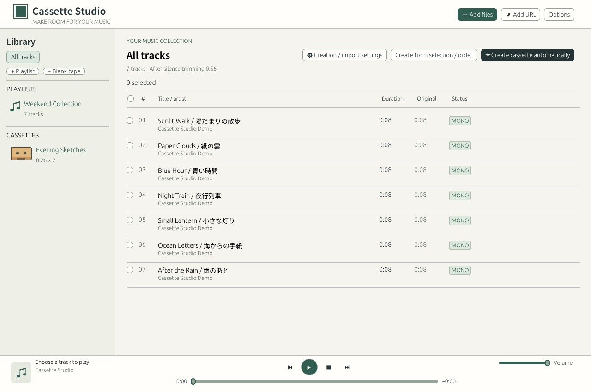

Select All tracks, a playlist or a cassette on the left. Track status uses compact badges; right-click Properties provides details. Reading/import/analysis and completion/errors are shown explicitly.

## 2. Track properties and editing

Right-click tracks for playback, loudness adjustment, LUFS graphs, selected loudness/DC analysis, selected silence reanalysis, properties and removal. Multi-selection applies analysis/removal to selected tracks only. Mono sources have one combined Loudness / pseudo stereo command.

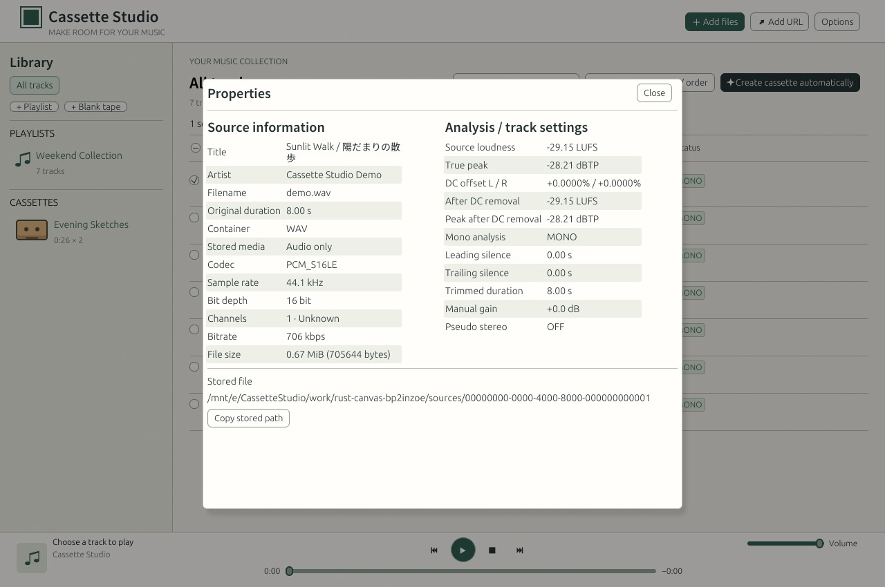

Properties combine available container/codec, sample rate, bit depth, channels, tags, storage details, trims and measured loudness/peak/DC. Compressed formats do not display a misleading PCM bit depth. MP4-family names use available brand and video-stream information. Leading/trailing silence analysis scans the tail backwards and preserves intentional silence inside a song; changed audible lengths update related mixes. Recoverable Shift_JIS/CP932 tag misdecoding is repaired, but lost characters cannot be recovered.

## 3. Create and edit cassettes

- Create from selection/order prioritizes list order; no selection means all tracks are candidates.
- Automatic creation excludes tracks already used in existing cassettes. Prepared blank tapes use their individual saved durations and receive non-overlapping selections.
- Create a blank tape first when you want to set its recording duration before filling it.
- Suggested names are numbered. Creation and rename fields use the same large input as URL import.

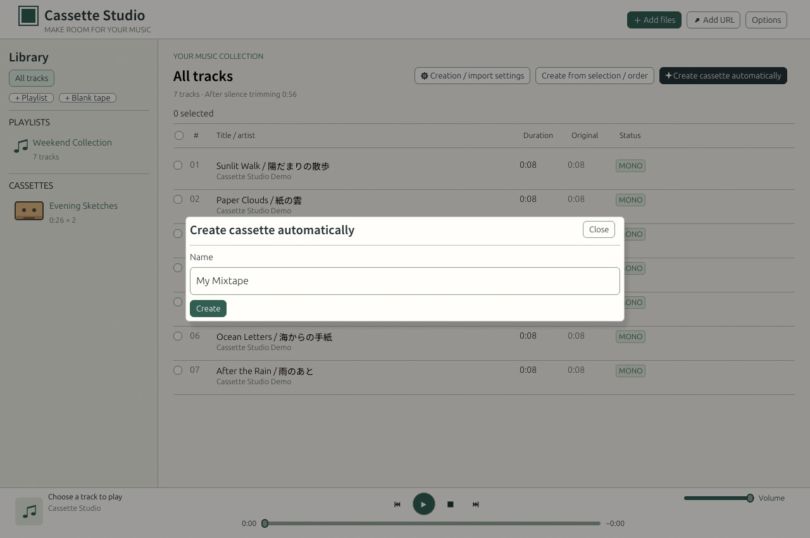

Add/remove tracks and reorder with arrows or drag/drop. Dragging shows the song, one insertion line per gap and edge auto-scrolling. Reordering saves without a completion popup. All tracks has a fixed library order.

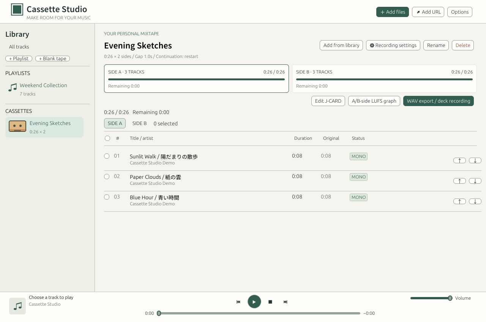

## 4. Recording settings

Recording settings belong to the selected cassette; creation/import settings are defaults. Tape presets are 46/60/74/80/90/120 minutes and Custom. Side duration uses minutes and seconds. Settings cover gaps, leading silence on A/B, fades, loudness normalization/target/peak ceiling, DC removal, silence detection and WAV format. Gap/leading-silence/fade controls use half-second steps. Minimum silence uses 0.1-second steps and defaults to 0.5 seconds. WAV choices are Unset, 16-bit 48 kHz and 16-bit 44.1 kHz, including DAT workflows.

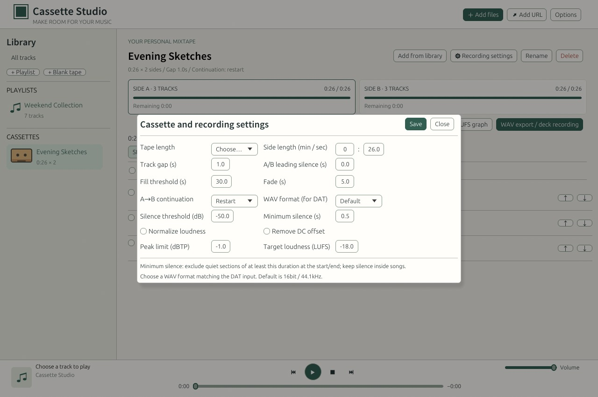

Overflow follows fade settings; side B can restart the split track or continue with fade-in. Manual additions fill side B too. Right-click Playback range / fades and use Auto fit to adjust the ending or remove unnecessary fades. Playback length is displayed in tenths of a second.

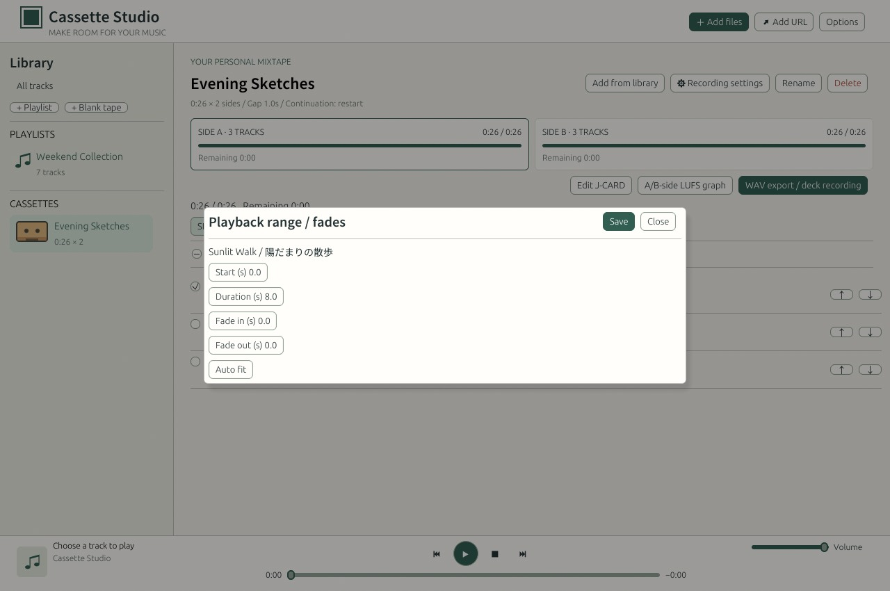

## 5. Levels and LUFS

Normalization uses measured loudness and peak limits, with optional manual gain and DC removal. Mono detection and pseudo stereo settings are shared source data. Pseudo stereo offers Off/Weak/Standard/Strong, shown in status badges; stronger settings increase width and tonal change. The dialog includes audition/stop controls.

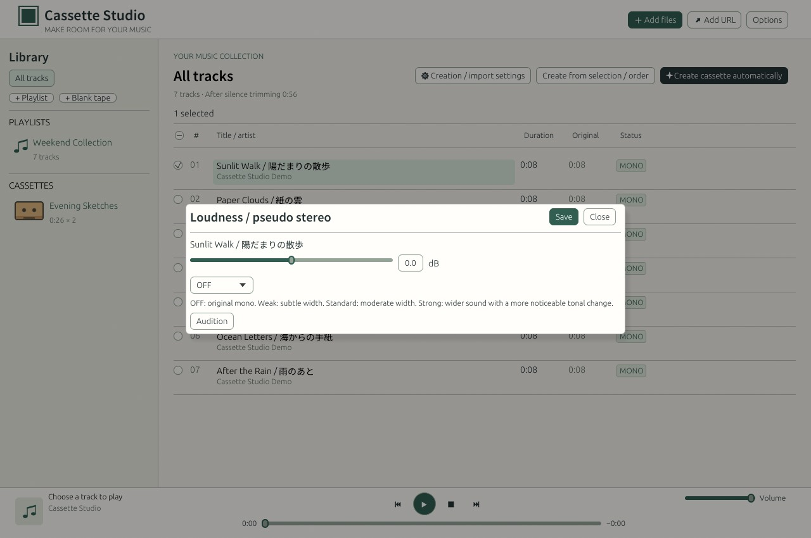

Track and complete A/B-side LUFS graphs show original audio as a red dashed line and processed audio separately. Analysis is labeled while running. Reusable track measurements are shared; whole-side results use the actual order, ranges, fades and gaps of that output.

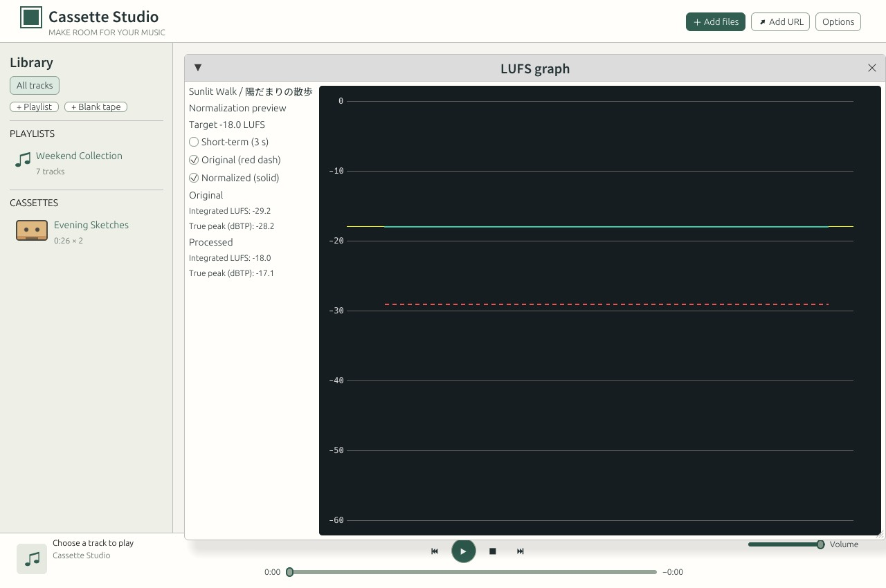
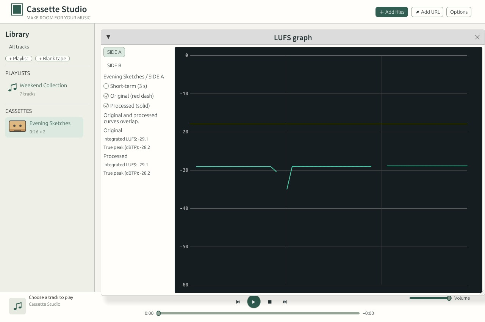

## 6. Normal playback and dedicated recording

The bottom transport controls normal playback. Double-click/context playback retain source list and position. One selected track starts at that position in the full list; multiple selected tracks form a selected queue. Previous/next navigate tracks; browsing another list does not change the queue. Cassette playback displays a preparation dialog while generating/loading audio, dismisses it when ready and starts playback. Closing it cancels late playback.

WAV export / deck recording combines side downloads and dedicated recording. Generated WAV files are reused while order, ranges, settings and audio measurements remain unchanged. Renaming alone does not regenerate audio. An application restart may require generation again.

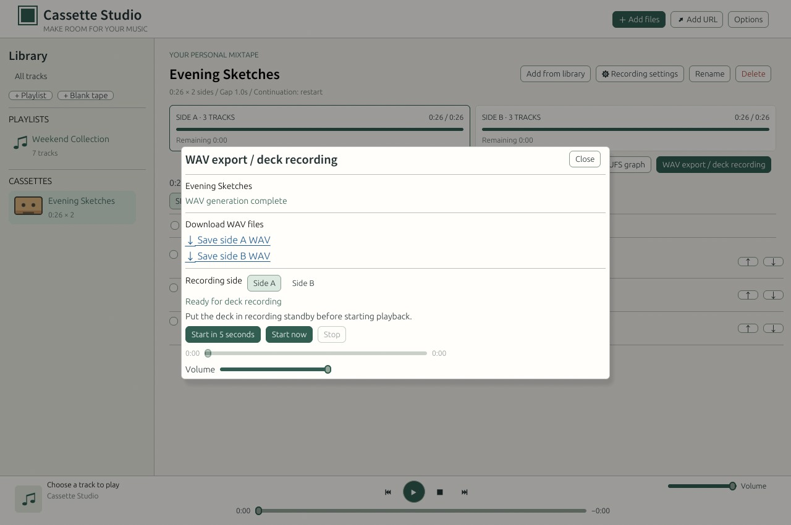

Choose side A/B and use playback/pause/stop, position, volume or Start in 5 seconds. Recording has its own player and countdown. Entering stops normal playback; closing stops recording playback and cancels the countdown. Download A/B WAV files from the dialog; save results stay inside it.

## 7. Options, storage and browser use

Options contains reference tone and language. Keep the output-path level fixed and align the deck meter to 0 dB with the reference tone. Language supports Auto/Japanese/English; Auto chooses Japanese only for a Japanese environment. Analyze tracks from their context menu.

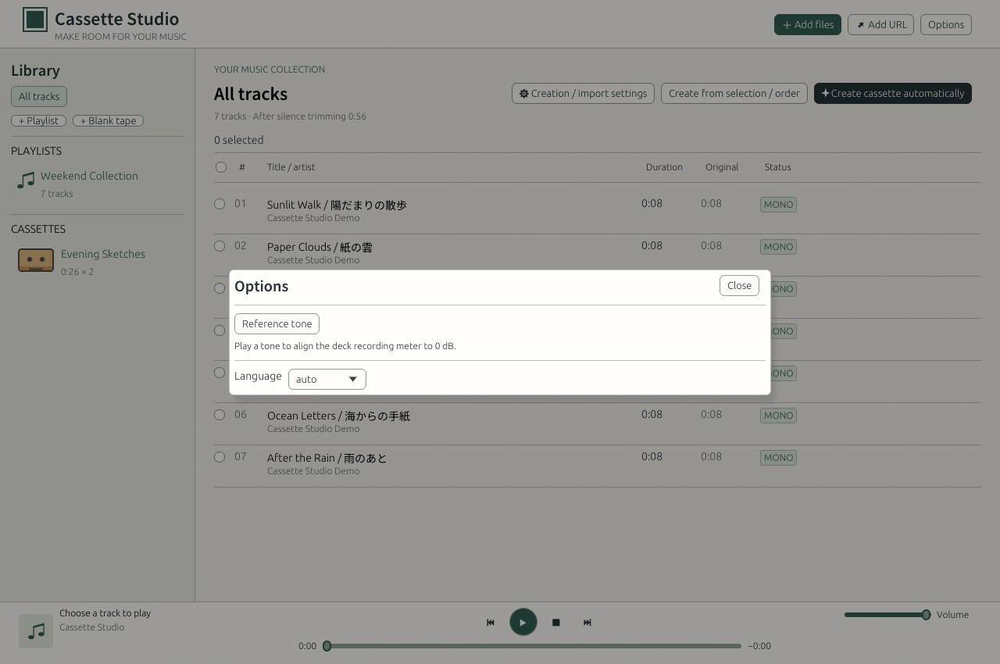

Back up the complete data folder, including library, copied sources and J-CARDs. Traditional, Flatpak and AppImage data folders are separate and can coexist; see installation for paths. The browser uses the same Rust UI and requires the local audio engine. Output-device selection appears only on supported desktop builds. A Dolby B/C-compatible encoder is not implemented.
